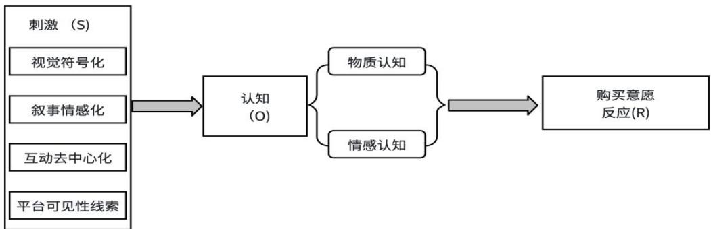
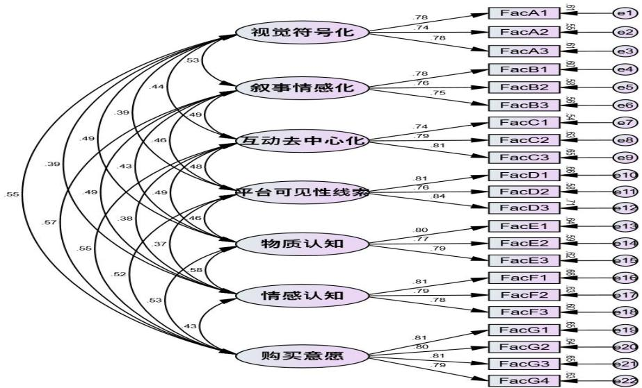
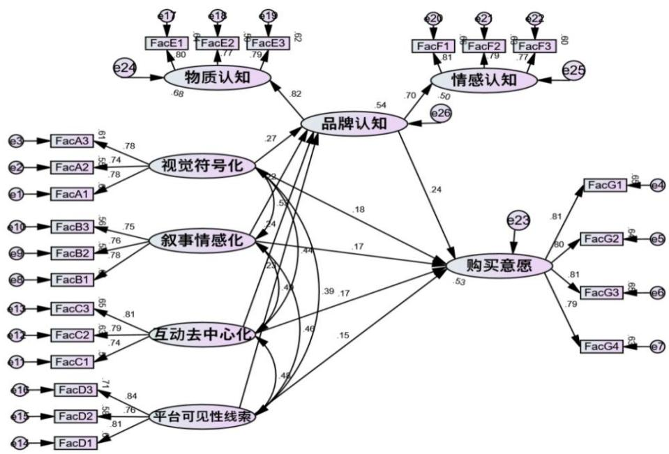

分类号

密级

UDC

# 硕 士 学 位 论 文

## 奢侈品品牌形象的媒介化呈现对消费者购买意愿的影响研究——以Gucci为例

作 者 姓 名 ： 肖 玉 琳

学 科 专 业 ： 新 闻 与 传 播

学 号： 212023055200019

指 导 教 师 ： 刘 茜

完 成 日 期 ： 2026 年 12 月

Classified Index:

UDC:

Chengdu University Master Degree Dissertation

# The Impact of Mediatized Presentation of Luxury Brand Image on Consumers’ Purchase Intention: A Case Study of Gucci

Candidate:

Major: Journalism and Communication

Student ID:

Supervisor:

## 摘 要

随着中国奢侈品市场数字化进程持续深化，社交媒体已成为奢侈品品牌意义生产、形象建构与消费者认知塑造的重要传播场域。微博凭借公域扩散、话题聚合与节点传播等平台特征，成为国际奢侈品品牌在中国市场开展本土化传播的重要阵地。然而，奢侈品品牌在社交媒体传播过程中始终面临流量获取与品牌调性维护之间的张力。既有研究多从营销策略、品牌管理和消费者行为视角展开讨论，对平台媒介逻辑如何塑造品牌形象呈现方式，以及这种呈现方式如何经由消费者认知加工影响行为意向的研究仍相对不足。基于此，本文以微博平台为研究场景，以Gucci 为案例，结合媒介化理论、深度媒介化理论与S-O-R理论，构建“媒介化呈现—品牌认知—购买意愿”的分析框架，并将奢侈品品牌形象的媒介化呈现操作化为视觉符号化、叙事情感化、互动去中心化和平台可见性线索四个维度。需要说明的是，本文所考察的购买意愿属于传播效果链条中的行为意向指标，并不等同于实际购买行为或市场销售结果。

在研究方法上，本文以问卷调查法为核心研究方法，共获得350份有效样本，并运用 SPSS 26.0 与 AMOS 24.0 进行信效度检验、结构方程模型分析及 Bootstrap 中介效应检验。研究结果表明：第一，视觉符号化、叙事情感化、互动去中心化和平台可见性线索均对消费者购买意愿具有显著正向影响，其中视觉符号化的作用相对更为突出；第二，品牌认知在媒介化呈现各维度与购买意愿之间发挥部分中介作用，说明品牌传播刺激需要经过消费者认知加工，才能进一步影响其购买意愿；第三，品牌认知包含物质认知、情感认知两个子维度，二者共同组成消费者整体品牌认知。

本文将媒介化理论引入奢侈品品牌微博传播研究，从新闻传播学视角解释品牌形象在平台逻辑中的建构机制，拓展了媒介化理论在商业传播情境中的应用边界。同时，研究结论也为奢侈品品牌在中国本土社交媒体中平衡平台可见性与品牌调性、优化视觉表达、叙事建构和互动传播提供了经验参考。

关键词：奢侈品品牌；媒介化呈现；微博；品牌认知；购买意愿

## Abstract

With the continuous digitalization of China’s luxury market, social media has gradually become an important communication arena for brand meaning production, brand image construction, and consumer cognition formation. Owing to its platform features such as public diffusion, topic aggregation, and node-based dissemination, Weibo has become an important platform for international luxury brands to conduct localized communication in the Chinese market. However, luxury brands on social media have long faced the tension between traffic acquisition and the maintenance of brand tone. Existing studies have mainly examined luxury brand communication from the perspectives of marketing strategy, brand management, and consumer behavior, while insufficient attention has been paid to how platform media logic shapes the presentation of brand image and how such presentation influences consumers behavioral intention through cognitive processing. Therefore, taking Weibo as the research context and Gucci as the case, this study draws on mediatization theory, deep mediatization theory, and the S-O-R theory to construct an analytical framework of “mediatized presentation—brand cognition—purchase intention”. The mediatized presentation of luxury brand image is operationalized into four dimensions: visual symbolization, narrative emotionalization, interactive decentralization, and platform visibility cues. It should be noted that purchase intention in this study refers to consumers’ subjective behavioral intention within the chain of communication effects, rather than actual purchase behavior or market sales performance.

In terms of research method, this study adopts questionnaire survey as the core research method and obtains 350 valid samples. SPSS 26.0 and AMOS 24.0 are used to conduct reliability and validity tests, structural equation modeling, and Bootstrap mediation tests. The findings show that, first, visual symbolization, narrative emotionalization, interactive decentralization, and platform visibility cues all have significant positive effects on consumers’ purchase intention, among which visual symbolization shows a relatively stronger effect. Second, brand cognition plays a partial mediating role between each dimension of mediatized presentation and purchase intention, indicating that brand communication stimuli need to be processed through consumers’ brand cognition before further influencing purchase intention.Third,brand cognition consists of two sub-dimensions: material cognition and emotional cognition, which jointly form consumers’ overall brand cognition.

This study introduces mediatization theory into the research of luxury brand communication on Weibo and explains the construction mechanism of brand image under platform logic from the perspective of journalism and communication. It expands the application of mediatization theory in commercial communication contexts and provides empirical implications for luxury brands to balance platform visibility and brand tone in China’s social media environment.

Key words: Luxury Brand; Mediatized Presentation; Weibo; Brand Cognition; Purchase Intention.

## 目 录

摘要....I
Abstract....II
1 绪论....7
1.1 研究背景....7
1.2 研究内容....8
1.2.1 研究对象....8
1.2.2 研究问题....9
1.2.3 研究方法....9
1.3 研究意义....10
1.3.1 理论意义....10
1.3.2 实践意义....10
1.4 研究思路与技术路线....11
1.4.1 研究思路....11
1.4.2 技术路线....11
2 文献综述及理论基础....13
2.1 国内外研究现状....13
2.1.1 奢侈品品牌传播研究....13
2.1.2 社交媒体平台对奢侈品品牌形象传播的研究....15
2.1.3 奢侈品品牌形象的媒介化呈现研究....16
2.1.4 品牌形象与品牌认知研究....18
2.1.5 消费者购买意愿研究....20
2.2 理论基础....22
2.2.1 媒介化理论....22
2.2.2 深度媒介化理论....23
2.2.3 S-O-R 理论....24
2.3 本章小结....26
3 模型构建与变量定义....27
3.1 变量提取....27
3.1.1 奢侈品品牌形象的媒介化呈现....27
3.1.2 品牌认知....31
3.1.3 购买意愿....32
3.2 模型构建....33
3.3 研究假设....33

3.4 本章小结....34
4 研究设计....35
4.1 调查方法....35
4.2 研究对象....35
4.3 问卷设计与量表开发....36
4.3.1 奢侈品品牌形象的媒介化呈现量表....36
4.3.2 品牌认知量表....39
4.3.3 购买意愿量表....40
4.3.4 问卷题项总表....41
4.4 Gucci 官方微博传播实践与同类品牌横向参照分析....43
4.4.1 补充分析目的与资料来源....43
4.4.2 Gucci 官方微博传播实践的媒介化呈现分析....45
4.4.3 同类奢侈品品牌横向参照分析....47
4.4.4 补充分析小结....49
4.5 本章小结....50
5 数据分析....51
5.1 描述性统计分析....51
5.1.1 人口统计学特征....51
5.1.2 变量描述性统计....52
5.2 信度与效度检验....53
5.2.1 信度检验....54
5.2.2 效度检验....55
5.3 相关性分析....59
5.4 结构方程模型（SEM）分析....60
5.4.1 模型构建与拟合....60
5.4.2 假设检验结果....62
5.4.3 效应强度对比....64
5.5 中介效应检验....64
5.5.1 中介效应检验结果....64
5.5.2 中介效应详细解读....65
5.6 研究假设检验总结....66
6 研究结论与启示....68
6.1 研究结论....68
6.1.1 奢侈品品牌形象的媒介化呈现四维体系的有效性与适配性检验....68

6.1.2 品牌认知双维度构成与中介传导机制的实证检验....69
6.1.3 媒介化双元取向维度的作用效应差异分析....69
6.1.4 媒介化传播实践对奢侈品传播张力的启示....70
6.2 奢侈品品牌微博媒介化传播优化策略....70
6.2.1 强化视觉符号体系的标准化建构与质感呈现....70
6.2.2 深化品牌叙事表达与价值共鸣建构....71
6.2.3 关注互动传播网络与用户参与机制....72
6.2.4 兼顾平台可见性经营与规则适配....73
6.2.5 推动多维度协同与品牌传播张力的调节....73
6.3 研究局限与未来展望....74
6.3.1 研究局限....74
6.3.2 未来展望....75
参考文献....77
附录 奢侈品品牌形象的媒介化呈现对消费者购买意愿的影响研究调查问卷....81
致 谢....87

## 1 绪论

## 1.1 研究背景

在数字媒介持续重塑消费社会的背景下，社交媒体已逐渐从信息传播渠道转变为品牌意义生产与消费者认知塑造的重要场域。对于奢侈品品牌而言，其传播价值不仅体现在产品信息传递层面，更体现在稀缺性、身份感、审美风格与文化意义的持续建构之中。随着中国奢侈品消费市场的线上化、年轻化趋势不断加深，微博、微信、小红书、抖音等平台已成为国际奢侈品品牌开展本土化传播的重要媒介环境。相较于传统单向传播方式，社交媒体平台在可见性组织、话题扩散、互动参与和情绪传导等方面，对品牌形象的建构方式产生了更为直接的影响。

在诸多社交媒体平台中，微博凭借其公域传播、话题聚合、明星与 KOL 节点扩散等媒介特性，成为奢侈品品牌进行事件传播、形象建构与舆论扩散的重要平台。相较于封闭式或私域传播环境，微博的广场式传播机制更有利于品牌实现规模化曝光，其平台特征与奢侈品品牌所强调的符号价值传递、身份表达和仪式感建构具有较高适配性。以Gucci 为代表的国际奢侈品品牌，已将微博作为中国市场重要的官方传播场域，在新品发布、品牌活动、文化叙事和明星合作等传播实践中具有较高活跃度。从客观传播数据来看，Gucci 官方微博账号（@GUCCI）粉丝规模持续稳定，内容覆盖新品发布、时装秀直播、明星代言、品牌文化叙事与话题互动等多类型传播形态，在重要营销节点（如代言人官宣、新品发布季、中国传统节日）期间，相关微博话题的阅读量可达数亿次级别，互动量亦显著高于日常内容。据克劳锐 2023年奢侈品社交媒体传播报告显示，Gucci在微博平台的传播活跃度与话题聚合能力在国际奢侈品品牌中位居前列，其内容在热搜曝光、KOL 联动频次与话题参与规模方面均保持较高水平[1]。这一客观传播基础表明，Gucci 在微博平台具有较强的品牌可见性与受众覆盖能力，也为本研究以 Gucci 微博传播作为研究场景提供了现实依据。由此，微博不仅是品牌信息发布的平台，也是观察品牌如何在平台逻辑约束下调整表达方式的重要窗口。开云集团近年来持续将社交媒体纳入品牌传播体系并强化数字化传播策略[2]。这也为观察 Gucci 在平台环境中的传播实践提供了现实背景。

但在实践过程中，奢侈品品牌在微博平台的传播中也面临明显张力。一方面，品牌需要借助平台机制提升内容曝光与社会讨论度：另一方面过度依赖流量逻辑又可能削弱奢侈品品牌所强调的距离感、稀缺感与高端调性。如何理解在平台化传播环境下品牌形象的重构机制，进而解释其对消费者购买意愿的影响，成为新闻与传播学研究中值得关注的重要议题。

现有研究多从营销传播、消费者行为或品牌管理视角讨论奢侈品社交媒体传播问题，对于平台逻辑如何塑造品牌形象呈现方式以及这种呈现方式如何通过品牌认知进一步影响购买意愿的研究仍相对不足。基于此，本文选取微博平台中的 Gucci 品牌传播作为研究对象，尝试从媒介化理论出发，对奢侈品品牌形象的媒介化呈现及其作用机制展开实证研究。

## 1.2 研究内容

## 1.2.1 研究对象

本研究选取微博平台 18-40 岁、曾经浏览过Gucci 官方微博相关内容的消费者作为调研对象，研究仅围绕Gucci 单一品牌展开，属于单案例实证分析，研究结论不能直接套用在 LV、香奈儿等其他奢侈品牌。问卷依托社交社群采用方便抽样结合滚雪球抽样方式收集样本，样本结构偏年轻化，研究结论存在样本层面的适用局限。选择微博作为单一研究平台，核心源于平台媒介属性与奢侈品本土传播的场景适配性。第一，微博具备公域广场式的传播机制，依托热搜引爆、话题聚合、明星与 KOL 节点扩散功能，可实现品牌信息规模化公域曝光，契合奢侈品品牌符号传播与圈层渗透的核心诉求；第二，微博形成了以视觉内容为核心的内容生态，高清海报、短视频等形态适配用户碎片化的媒介接触习惯，为奢侈品通过视觉符号传递品牌调性提供适配载体；第三，微博构建去中心化的互动传播网络，品牌官方、KOL、普通用户可通过话题参与、评论互动等形式形成多元传播链路，为奢侈品品牌与用户沟通提供完整场域。

从传播实践看，微博已成为国际奢侈品品牌在中国市场进行事件传播、品牌展示与明星联动的重要平台。Gucci、Louis Vuitton、Chanel 等品牌均在微博承担新品发布、秀场传播、代言合作和品牌活动官宣等功能。现有研究中，关于奢侈品社交媒体传播的讨论多集中于跨平台营销策略与品牌年轻化表达，针对微博平台特性展开的传播学实证研究仍相对有限。基于此，选择微博作为研究平台，有助于更清晰地观察平台逻辑如何介入品牌形象的组织与呈现；选择Gucci 作为单案例，则有助于在较为典型的品牌传播实践中展开具体分析。

学界围绕Gucci 已形成较为丰富的研究成果。雷逸阳等将 Gucci 发展划分为四个阶段，指出2015 年后 Alessandro Michele 主导的年轻化、复古极繁、多元包容风格使其实现业绩反弹并重塑品牌形象[1]；易鑫认为Gucci 通过设计革新、门店焕新、数字化运营与社交传播成功抓住千禧一代消费者，成为传统奢侈品牌转型标杆[2]；屈琬莹以 Michele时期Gucci 时装秀为对象，提炼出三大叙事阶段与核心意象，揭示其新旧交融与矛盾拼贴的整体主题，证实 Gucci 具备极强的符号性、叙事性与媒介呈现特征[1]；同时现有研究普遍认可Gucci 是奢侈品数字化与社交传播先行者，但其成果多从营销、管理、符号学视角展开，从媒介化理论系统拆解其微博呈现维度的实证研究较为稀缺。

结合文献梳理与品牌传播实践，本文选择Gucci 作为单案例研究对象，主要基于两点考虑：其一，Gucci 作为国际奢侈品品牌，经历了较为典型的品牌调整与传播转型过程，具有一定代表性；其二，Gucci 较早进入中国本土社交媒体平台，并在微博场景中形成了较为稳定的品牌表达与传播实践，能够为本文提供较为清晰的研究观察对象。

## 1.2.2 研究问题

本研究以媒介化理论为核心视角，围绕微博平台中奢侈品品牌传播实践的实践场景与理论缺口，拟解决以下研究问题：

1.微博场景下奢侈品品牌形象的媒介化呈现主要包含哪些维度，这些维度如何体现平台逻辑对品牌传播实践的塑造作用？

2.奢侈品品牌形象的媒介化呈现是否会显著影响消费者购买意愿，不同维度的影响强度是否存在差异？

3.品牌认知是否在媒介化呈现与消费者购买意愿之间发挥中介作用，其作用路径呈现出怎样的机制特征？

## 1.2.3 研究方法

本研究以问卷调查法为核心研究方法，遵循新闻与传播学科理论推演到实证检验再到实践应用的研究范式，始终聚焦核心研究问题展开系统性研究，确保研究结论的科学性、客观性与学科适配性。以微博平台中接触过Gucci 品牌内容的消费者及奢侈品潜在消费群体为调研对象，参考国内外成熟量表结合研究场景设计标准化调查问卷，通过线上渠道完成问卷发放与回收，对回收问卷进行有效性筛选后，形成最终研究样本，为本研究的实证分析提供数据支撑。

本研究通过文献系统梳理媒介化理论、深度媒介化理论、奢侈品品牌传播、社交媒体品牌形象建构、品牌认知与消费者购买意愿等相关领域的国内外文献，厘清核心概念的内涵与理论边界，总结现有研究的核心成果与学术缺口，为本研究的维度界定、模型构建与假设提出奠定理论基础，同时为量表设计提供经典文献参考。

此外，本文借助SPSS26.0和AMOS 24.0对样本数据进行处理与分析。具体而言，通过信度分析和效度分析检验量表的可靠性与有效性：通过描述性统计分析样本人口统计学特征与变量分布情况；通过相关分析初步判断变量间关系；最终运用结构方程模型检验研究假设，并通过Bootstrap 法检验品牌认知的中介效应。

## 1.3 研究意义

## 1.3.1 理论意义

第一，本研究尝试将媒介化理论引入奢侈品品牌社交媒体传播研究，拓展媒介化理论在商业传播场景中的应用边界。既有关于奢侈品传播的研究多聚焦营销策略、品牌管理及消费行为，对平台媒介逻辑如何参与品牌意义生产与形象建构的讨论相对不足。本文聚焦微博公域传播、话题聚合、节点扩散特征的平台特征，考察奢侈品品牌在平台逻辑作用下形成的媒介化呈现形态，有助于丰富媒介化理论在数字传播实践中的解释力。

第二，本研究构建了媒介化呈现—品牌认知—购买意愿的分析框架，为理解社交媒体语境下品牌传播效果的形成机制提供了新的解释路径。相较于既有研究多关注传播刺激与行为结果的线性关系，本研究进一步引入品牌认知这一心理中介变量，有助于揭示品牌传播影响消费者行为意向的内在机制。

第三，本研究以微博为具体研究场景，在一定程度上补充了奢侈品品牌传播研究的情景化研究依据。现有相关研究多依赖西方消费语境或展开多平台泛化分析，对微博平台的热搜机制、明星节点效应、互动逻辑及其对品牌传播的深层影响关注不足。本文聚焦中国本土社交平台，考察奢侈品品牌形象的媒介化呈现特征与传播效果，本研究有助于提升研究的本土解释力。

## 1.3.2 实践意义

第一，为奢侈品品牌优化微博传播内容提供较为明确的分析依据。奢侈品品牌在社交媒体传播中始终面临扩大可见性与维持品牌调性之间的张力，本研究从媒介化呈现角度出发，分析视觉符号、叙事方式、互动形式与平台可见性线索对消费者认知与购买意愿的影响，可为品牌在微博传播实践中更有针对性地优化内容组织方式提供参考。

第二，推动奢侈品品牌从流量导向转向认知导向传播。社交媒体传播效果并非仅体现为短期曝光或互动数据的增长，更体现为消费者对品牌价值的理解与认同。本研究明确品牌认知在媒介化呈现与购买意愿之间的中介作用，能够为品牌制定传播策略提供更清晰的认知路径参考，即通过优化内容呈现增强消费者的物质认知与情感认知，进而增强购买意愿和传播效果。

第三，为奢侈品品牌中国本土化传播提供可落地的策略启示。微博作为奢侈品品牌公域造势、事件传播、节点联动的核心阵地，其平台规则与传播逻辑具备本土代表性。本研究围绕微博平台展开研究，不仅有助于品牌理解平台规则如何影响传播效果，也有助于在内容策划、节点协同、话题运营与用户互动等环节提供贴合本土平台的传播策略，助力国际奢侈品品牌适配中国市场传播生态。

## 1.4 研究思路与技术路线

## 1.4.1 研究思路

本研究以理论推演→模型构建→实证检验→实践应用为核心研究逻辑，基于媒介化理论与S-O-R（刺激—有机体—反应）理论为支撑，构建微博平台奢侈品品牌形象的媒介化呈现的四维分析体系。检验其对品牌认知及购买意愿的直接及间接作用，形成完整的理论验证和实践指导逻辑链。

## 1.4.2 技术路线

本研究遵循新闻与传播学科的研究逻辑，以媒介化理论为核心分析视角，以Gucci为研究载体，以理论构建、实证检验、实践应用为核心脉络，具体如下：

第一阶段：理论准备与框架构建。结合奢侈品数字化传播趋势与媒介化理论研究现状，确定研究主题与核心研究内容，明确研究边界；系统梳理国内外相关领域的权威文献，完成文献综述，厘清核心概念的内涵与边界，总结现有研究的学术缺口；基于媒介化理论的核心逻辑，结合奢侈品品牌的符号传播特征，推演奢侈品品牌社交媒体媒介化呈现的核心维度，科学界定各维度内涵与操作化表征，构建维度体系。

第二阶段：研究模型与假设提出。基于S-O-R（刺激——机体——反应）理论，将媒介化呈现作为刺激变量，品牌认知作为机体变量，购买意愿作为反应变量，构建媒介化呈现→品牌认知→购买意愿的整合研究模型；结合现有研究成果与构建的研究模型，提出媒介化呈现各维度对购买意愿的直接影响假设，及品牌认知的中介效应假设，形成完整的研究假设体系。

第三阶段：研究工具设计与预调研。参考新闻与传播学科、消费者行为学的经典量表，结合本研究的研究场景与Gucci 品牌传播特征，开发奢侈品品牌形象的媒介化呈现量表、品牌认知量表与购买意愿量表，形成初始调查问卷；选取小样本（N≥50）进行预调研，通过信度与效度分析修正量表题项，优化问卷内容与表述，形成正式调查问卷。

第四阶段：数据收集与筛选以微博平台的Gucci消费者及奢侈品潜在消费者为调研对象，通过线上渠道发放正式调查问卷；对回收的问卷进行有效性筛选，剔除无效样本，得到最终研究样本，为后续实证检验提供数据支撑。

第五阶段：实证检验与结果分析。运用 SPSS26.0 对样本数据进行信度分析、效度分析、描述性统计分析与 Pearson 相关分析，检验数据的可靠性与变量间的相关性；运用AMOS24.0 构建结构方程模型，对研究假设进行系统性实证检验；分析媒介化呈现各维度对消费者购买意愿的影响效应强度以及品牌认知的中介传导机制与效应差异

第六阶段：结论总结与策略提出。系统总结研究结论，全面回应本研究提出的核心研究问题，提炼研究创新点；基于研究结论，从新闻与传播学科视角提出适配微博平台的奢侈品品牌形象的媒介化呈现优化策略，为Gucci 及同类奢侈品品牌提供实践参考；分析研究局限，结合行业发展趋势与学术研究前沿，对未来媒介化理论视角下的奢侈品品牌传播研究方向进行展望。

## 2 文献综述及理论基础

## 2.1 国内外研究现状

## 2.1.1 奢侈品品牌传播研究

奢侈品品牌传播的核心在于符号价值的传递与高端品牌形象建构，奢侈品品牌传播的核心并不止于产品信息传递，而在于通过符号、叙事与文化意涵的持续生产，建构品牌所代表的身份区隔、审美风格与价值想象。与一般消费品相比，其价值不仅源于产品功能属性，更依托稀缺性、审美溢价、身份象征与文化意涵形成差异化竞争壁垒[1]。因此其传播研究天然具有跨越品牌管理、消费文化与媒介传播的复合特征。

现有研究首先从营销传播与品牌管理视角讨论奢侈品品牌传播，重点关注传播渠道、内容策略 整合营销和数字化转型等问题 李蓝天以整合营销传播模型对国外奢侈品品牌在中国的传播策略进行分析，从媒体渠道，传播内容，广告营销，公关营销等多种传播展开，并以 Burberry 为案例探讨对中国时尚品牌的借鉴意义[2]。于睿茜聚焦新媒体语境，分析Burberry 的广告传播、公关营销、人际传播和终端策略[3]。李若冰则从社交媒体、内容营销和数字营销三个角度，提出了皮具奢侈品品牌的传播创新策略[4]。此外，黄轶群以 4P 营销理论为框架，以爱马仕品牌为例分析奢侈品传统营销策略[5]。黄鑫娅以IMC 理论为立足点，以Gucci 为案例剖析传统奢侈品品牌的转型方向与实施路径[6]。曹亚婷以Burberry 为研究对象，指出奢侈品数字化营销策略呈现出社交媒体、意见领袖与电子商务协同推进的特征，认为品牌营销的最终目的是引导受众消费，以此完成数字营销过程[7]。这类研究强调品牌如何通过广告、公关、社交媒体和终端陈列实现高端形象维护与市场触达扩展，为理解奢侈品品牌传播的策略层面提供了重要基础。

另一部分研究则从符号学、消费文化与身份建构视角切入，关注奢侈品如何借助视觉符号和神话叙事。Bourdieu从文化资本理论视角指出奢侈品传播通过稀缺性符号分配实现精英阶层与大众群体的区隔[8]。郭涵喆从皮尔斯符号学的角度研究迪奥香水广告的符号意义建构，认为奢侈品牌通过想象价值传递影响受众认知与观念[1]。朱晓辉的实证研究明确了中国消费者对奢侈品身份象征的核心诉求[2]。张梦霞则从消费价值观角度，阐释奢侈品符号价值与消费者自我认同的关联[3]。这类研究揭示了奢侈品传播区别于一般商品传播的重要特征，即其价值更多来源于象征意义的建构而非单纯功能信息的传递。

还有研究从消费行为与品牌感知角度出发，探讨感知价值、品牌态度、社会影响与购买意愿之间的关系，强调奢侈品传播如何通过塑造品牌印象、激发身份认同和情感满足影响消费者行为倾向。国外早期研究奠定了奢侈品消费动机的理论基础，Veblen 提出炫耀性消费概念[4]，认为奢侈品消费的核心在于身份彰显与炫耀需求；Dubois 和Laurent则补充了完美主义与享乐主义动机，强调个体对品质与体验的内在追求[5]。Wiedmann等人进一步指出，品牌传播所传递的价值理念会影响消费者的个人价值判断，进而改变其对奢侈品的期望与购买意向[6]。叶斯妤对不同级别奢侈品品牌的定位和受众进行区分，探讨与之匹配的品牌代言传播策略[7]。

当前国内关于奢侈品品牌的研究深度贴合中国本土品牌传播语境。王慧在研究中发现，中国消费者的奢侈品消费动机更易受社会价值影响，这与品牌侧重符号传播的导向密切相关[8]。玲玲的研究发现，感知价值中的功能价值与情感价值对80后群体购买意愿具有显著正向影响，而品牌传播是塑造消费者对奢侈品感知价值的重要途径[9]。袁园从认知、情感、行为意向三层面构建奢侈品消费态度测量指标，发现不同态度类型的消费者在购买行为上存在显著差异[10]。

总体而言，现有关于奢侈品品牌传播的研究已经从传统精英化、单向度的传播模式研究，逐步转向数字平台语境中的品牌传播策略、符号建构与消费心理机制研究，为本文奠定了重要基础。然而，既有研究仍主要集中于营销管理和消费行为层面的解释，对平台媒介逻辑如何深层塑造品牌形象呈现方式的讨论相对不足，尤其缺少从新闻传播学视角出发，对品牌传播如何在具体平台中被重新组织与建构的系统分析。

## 2.1.2 社交媒体平台对奢侈品品牌形象传播的研究

随着社交媒体成为品牌传播的重要基础设施，奢侈品品牌的传播研究逐渐从是否进入社交媒体转向如何适应社交媒体平台逻辑。这一转变意味着，奢侈品品牌传播不再只是内容投放问题，而是品牌如何在互动机制、可见性竞争、节点扩散与用户参与中重构自身表达方式的问题。

国外研究普遍证实社交媒体对奢侈品传播具有正向作用，认为其不仅提升了品牌认知与用户参与，也在一定程度上重塑了消费者从线上研究到线下购买的决策路径。Wang的研究指出，品牌营销逐步转向通过社交平台与消费者开展互动，社交媒体营销不仅能够提升品牌认知、影响消费者购买决策流程，还可在增强消费者对奢侈品线上关注度的同时，一定程度上促进其线下购买行为[1]。Rienetta 等通过实证研究，揭示了迪奥、古驰、路易威登和巴宝莉等奢侈品牌在社交媒体上的强大影响力[2]。这类研究表明，奢侈品品牌在数字平台中的传播效果已不再局限于曝光层面，而是深度嵌入消费者认知与行为转化过程之中。

国内研究则更关注本土平台生态中奢侈品传播实践，尤其重视微博、抖音、微信等平台在品牌年轻化、本土化与互动传播中的作用。肖舒文、张庶萍以顶奢品牌抖音时装秀直播为例，证实多元场景融入可有效扩大品牌传播范围、提升传播效果[3]；李悦则进一步强调，在数字时代背景下，传统奢侈品牌需通过在社交媒体平台上推出系列文字创意项目等创新方式实现品牌转型，重塑传统品牌形象，吸引更多年轻消费者的关注与青睐[4]。这些研究说明，平台差异并非简单的技术差异，而是直接影响品牌内容形式、传播路径与受众感知方式的重要条件。

其中，微博因其公域传播、话题聚合、明星节点与热搜扩散等特征，成为奢侈品品牌在中国市场进行事件传播与形象建构的重要平台。樊颖利用 5W 理论对路易威登基于新浪微博营销的优劣势进行剖析 她认为 奢侈品微博营销承载着阐释品牌信息展示品牌特性、树立品牌形象的重要作用[5]。陶荣通过对路易威登、古驰、香奈儿等六大头部奢侈品品牌的实证研究进一步发现，微博是奢侈品品牌在中国市场进行年轻化传播的核心阵地，品牌通过微博的话题运营、明星代言、短视频内容等形式，完成了品牌形象的本土化与年轻化重构，这一过程正是品牌形象适配微博平台媒介逻辑的媒介化过程[1]。Gucci 在中国市场的社交媒体实践也为研究提供了典型样本，其数字化转型与本土化传播。汤子璇以Gucci 微信公众号为研究对象，解读其符号运用与营销活动，揭示了数字时代 Gucci 品牌形象重塑的核心逻辑[2]。周必超基于中国市场分析 Gucci 的营销战略，指出数字化能力是 Gucci 发展的核心支撑，中国市场是其品牌复苏的关键阵地[3]。印证了社交媒体公域与私域流量结合的传播效能，成为奢侈品平衡高端调性与大众传播的标杆。

现有研究已注意到微博在品牌年轻化传播与本土化表达中的价值，但更多仍停留在传播策略和案例经验层面，对品牌形象如何在微博平台逻辑下被重新组织与呈现，尚缺少更具解释力的理论框架。

综上，现有研究已经揭示了社交媒体平台对奢侈品品牌传播具有重要影响，也为本文理解微博平台中的品牌传播实践提供了研究支持。但整体而言，关于社交媒体平台的研究仍偏重传播效果与运营策略，对平台规则、传播结构与技术机制如何深层塑造品牌形象表达方式的讨论相对不足。由此，如何从媒介化视角解释奢侈品品牌在微博中的形象建构过程，成为本文进一步展开研究的重要切入点。

## 2.1.3 奢侈品品牌形象的媒介化呈现研究

在社交媒体语境下，奢侈品品牌形象的传播已不再是传统意义上的内容展示，而是受到平台规则传播结构 技术机制与用户参与共同塑造的动态建构过程 相较于一般品牌传播概念，媒介化呈现更强调品牌形象并不是静态地存在于媒介之中，而是在平台媒介逻辑不断渗透的过程中被重新组织、表达与扩散。对于奢侈品品牌而言，这种变化尤为明显，因为其品牌价值本身就高度依赖视觉符号、文化叙事和身份想象的传播建构。

## （1）媒介化理论的发展与核心观点

媒介化理论为理解数字平台中品牌传播提供了重要视角。相关研究指出，媒介并非中性的传播渠道 而是通过自身逻辑不断塑造社会实践的组织方式与运行规则在这一意义上，奢侈品品牌在社交平台中的传播，不应仅被理解为内容输出，而应被理解为对平台逻辑、传播规则与技术结构的适配性重构。Hjarvard指出，媒介化是媒介逻辑渗透社会各领域的过程，并且成为塑造社会制度与文化实践的重要力量[4]。Krotz 进一步提出，媒介化是一种长期的社会转型过程，媒介与社会文化之间持续互动形成新的传播结构与运行逻辑[5]。这一观点也得到了 Piatti-Farnell 通过跨文化对比研究的证实，他发现奢侈品品牌的媒介化呈现质量直接决定符号价值的传递效率[1]。冷南羲等学者在梳理国内媒介化理论研究时提出，媒介化理论逐渐成为国内学界阐释社会现象的重要视角，当前我国相关研究仍处于探索阶段，学界对其概念、范畴与研究路径的认知尚未形成统一共识[2]。胡翼青[3]的本土化解读提出，深度媒介化的核心是数字平台主导内容生产与社会互动，算法逻辑成为核心规则。这为社交媒体环境下奢侈品品牌传播提供了理论视角。数字技术推动媒介化理论演进为深度媒介化理论。Couldry 与Hepp[4]指出，数字平台时代的媒介不再是单纯的信息传递工具，而是通过算法、数据等技术手段，深度嵌入社会运行的各个环节中，构成媒介化社会的底层逻辑。Keller亦强调，奢侈品品牌需适配平台逻辑，才能实现品牌形象的有效传播[5]。

## （2）奢侈品品牌传播的本土研究与实践

奢侈品品牌传播天然依赖符号表达与文化叙事，其品牌价值并不直接来自产品功能，而更多来自视觉风格、品牌故事、身份象征和生活方式想象。喻国明、王璐遥指出，深度媒介化时代品牌传播已从内容适配转向逻辑共生，品牌需将平台算法规则、互动机制内化为传播策略[6]。陶荣针对奢侈品行业的实证研究显示，奢侈品品牌的传播渠道已全面转向社交媒体，品牌形象的呈现方式也从单向度的高端叙事，转变为适配平台特性的多维度表达，这一转变正是媒介化逻辑的直接体现[7]。

也有学者关注奢侈品品牌的符号表达与品牌叙事，屈琬莹以亚历山大・米开理时期的Gucci 时装秀为研究对象，提炼其新旧融合与矛盾拼贴的叙事主题与光学镜像、拼接融合的叙事手法，揭示了时装秀的品牌叙事逻辑[8]。彭传新提出，品牌文化与传奇叙事是奢侈品品牌价值的核心来源，社交媒体的媒介化环境则让品牌叙事从宏大的史诗性表达，转向更具情感共鸣的日常化、场景化叙事[9]。谢宏兴基于品牌文化视角，指出Gucci通过艺术营销借助艺术光环传递品牌文化内涵，实现品牌价值提升[10]。

因此，当品牌进入社交媒体平台后，其传播效果更容易受到平台可见性机制、互动结构和情绪传播逻辑的影响。由此可见，奢侈品品牌形象的传播过程尤其适合从媒介化视角加以分析。

## （3）奢侈品品牌形象的媒介化呈现的操作化定义

尽管已有研究从视觉表达、品牌叙事、社交互动和平台适配等方面分别讨论了奢侈品品牌传播问题，但整体上仍缺少一个能够整合这些维度、并适配微博语境的分析框架。尤其是在微博平台中，品牌形象不仅受到内容层面的视觉与叙事塑造，也受到热搜机制、话题标签、节点扩散和互动关系的共同影响。因此，有必要在媒介化理论框架下，对奢侈品品牌形象的媒介化呈现进行系统操作化界定。

胡翼青与张一可指出媒介化研究存在呈现性取向与物质性取向两种路径[1]，其中呈现性取向关注媒介内容与符号表达，物质性取向关注技术基础设施与互动建构，这一划分为奢侈品媒介化呈现的理论推演提供了核心框架。同时，综合上述文献梳理与理论推演，本研究将奢侈品品牌形象的媒介化呈现界定为：奢侈品品牌在数字平台媒介逻辑作用下，为实现品牌意义表达、形象建构与传播扩散，对视觉表达、叙事方式、互动结构与可见性组织进行适配性重构的传播实践。结合微博场景特征，本文进一步将其概括为视觉符号化、叙事情感化、互动去中心化和平台可见性线索四个维度，以期为后续实证分析提供可操作化框架。

## 2.1.4 品牌形象与品牌认知研究

品牌形象是人们对品牌的总体感知，它作为认知概念是消费者信息加工过程的重要组成部分[2]。大卫·奥格威[3]认为，消费者接触到的品牌信息经过选择、加工与整合后，在大脑中形成的关于品牌印象的总和，即为品牌形象。贝尔将其定义为消费者记忆中关于品牌的所有联想的总和，认为品牌形象通过公司形象、使用者形象和产品及服务形象得以体现[4]。

品牌形象与品牌认知是品牌传播研究中彼此关联但又有所区分的两个核心概念。前者更强调品牌在传播中被构建出来的整体印象与意义集合，后者则强调消费者在接触品牌信息后形成的理解、判断与评价。从传播效果的形成机制来看，品牌形象更多属于外部传播结果，品牌认知则是消费者对该结果进行心理加工后的内部表征。正因如此，品牌认知往往构成连接品牌传播与消费者行为的重要中介变量。

国内学者丰富了品牌形象的理论体系。范秀成､陈洁认为品牌形象反映顾客对品牌的感知。并构建了品牌形象综合测评模型，将品牌形象划分为产品维度、企业维度、人性维度和符号维度[1]。罗子明总结品牌形象的核心特征，指出其形成本质上是消费者对品牌信息的认知加工过程[2]。品牌形象包含具有外显性视觉符号与内隐性文化要素两类[3]。对于奢侈品品牌而言，内隐性元素中的文化内涵尤为关键，Gucci 通过将文艺复兴文化、希腊神话元素与现代潮流融合，借助艺术展览、文化营销等形式，构建了深厚的品牌文化壁垒，印证了符号与文化协同的重要性。高辉指出，奢侈品品牌形象的核心竞争力在于外显性符号的辨识度与内隐性文化的独特性的协同[4]。此外，赵瑜以路易威登在中国的品牌传播活动为案例，深入剖析了路易威登的营销传播策略如何有效助力其品牌形象的塑造与传播[5]。为国内品牌形象与品牌认知的研究提供了宝贵的实践参考。

品牌认知是消费者在接触品牌相关传播信息后，对品牌形成的理解、判断与价值评价过程，既体现为对品牌产品品质、设计水准等物质属性的认知，也体现为对品牌个性、价值理念与情感吸引力的认知。作为消费者对品牌形象进行心理加工的重要结果，品牌认知承担着连接品牌传播与消费行为的重要中介作用。Aaker 将品牌认知纳入品牌资产五星模型，将品牌认知视为品牌资产的核心构成维度[6]。Keller提出的以消费者为基础的品牌资产模型[7]则进一步完善了这一理论框架，清晰的品牌认知是品牌忠诚的前提。这一理论也为后续奢侈品品牌认知的研究奠定了核心基础。国内学者罗子明将品牌认知划分为产品属性认知与符号价值认知[8]。凡勃伦指出，奢侈品消费兼具实用与符号的双重属性[9]。陶荣通过对国内年轻奢侈品消费者的调研发现，中国消费者对奢侈品品牌的认知呈现出显著的双轨特征[10]。张家澳在符号消费视角下的时尚品牌数字化转型研究中进一步验证，在社交媒体环境下，消费者对奢侈品的认知更依赖符号互动与情感共鸣[11]。

社交媒体强化了品牌认知的中介作用。实证研究发现，社交媒体中品牌传播内容不会直接转化为消费行为，而是首先作用于消费者对品牌的认知与评价，再通过品牌认知的中介作用影响购买意愿。谢伟彤发现，社交媒体中的品牌信息呈现方式会通过影响品牌认知与价值感知，进而对其购买意愿产生显著影响[1]。袁胜军等学者则进一步指出，在奢侈品社交媒体传播中，消费者形成的品牌个性感知与情感联结，会通过品牌认知的中介作用正向影响消费意愿[2]。

总体而言，现有研究已经确认品牌认知在品牌传播与购买意愿之间具有重要作用，也逐步形成了理性认知与情感认知并存的研究共识。但在社交媒体平台语境下，关于不同媒介化呈现方式如何作用于品牌认知，以及品牌认知如何进一步连接平台传播与行为意向之间关系的研究仍然不够充分。本研究据此将品牌认知作为关键中介变量引入分析框架，以增强对传播作用机制的解释力。

## 2.1.5 消费者购买意愿研究

购买意愿是消费者行为研究中的经典变量，通常被视为实际购买行为的重要前置指标[3]。在传统营销研究中，购买意愿更多指向个体对产品或品牌的购买倾向；而在社交媒体语境下，由于平台兼具信息传播与社交扩散的双重属性，消费者的行为意向也呈现出更加复杂的外显形式，既包括直接购买倾向，也包括收藏、转发、推荐等前置性积极意向。

Godey 等指出，奢侈品的情感表达与象征性意义建构，会显著强化消费者的身份认同，进而提升其购买倾向[4]。奢侈品消费的非功能性特征决定了消费者的购买意愿并非单纯由产品物理属性决定，而是受到品牌认知、情感认同与身份象征意义的共同作用。杨靓文以问卷调查的形式分析微博、微信等社交媒体平台对奢侈品消费者购买意向的影响，结果发现社交媒体是推广品牌文化的良好平台，能够促进品牌与消费者之间的沟通与互动[5]。贾铮铮进一步指出，在抖音等短视频平台，购买意愿往往表现为一种被种草的心理状态，即消费者在浏览内容后产生的强烈的占有欲和分享欲，这种意愿可能即时转化为购买，也可能表现为长期的关注与收藏[6]。

社交媒体的传播特性进一步强化了购买意愿的情景化与社交化特征。陈洁的研究证实，对于奢侈品而言，享乐性价值（如社会地位、情感满足）对购买意愿的驱动作用显著强于功能性价值[7]。Schivinski和Dabrowski 指出在微博、微信等社交平台中，消费者对品牌的积极意向往往首先表现为收藏、转发、评论、品牌推荐、话题参与等非交易性行为[1]。这一发现揭示了社交媒体作为新兴传播渠道，对奢侈品消费行为产生的深远影响。

从购买意愿的形成机制来看，SOR理论已成为学界解释消费者购买意愿形成逻辑的核心分析框架。该理论由Mehrabian和Russell 提出，其核心逻辑在于，外部环境刺激会通过影响个体的内在心理与认知状态，进而作用于其最终的行为反应[2]。在数字场景的实证研究中，沈泽林基于 SOR 理论发现，电商直播的主播特征、产品属性、社会临场感可通过感知价值与感知风险的中介作用影响购买意愿，其中感知价值正向驱动购买意愿[3]；陈梦茹的研究则以KOL为核心刺激变量，证实KOL的专业度、交互性、推荐一致性可通过提升消费者信任间接正向影响购买意愿[4]；孙笑、刘振强均指出，电商直播的互动性、娱乐性、优惠性等特征，可通过感知价值、需求释放等中介变量推动购买意愿形成[5]；罗传挥等学者同样验证了直播场景中主播、产品、情景特征对购买意愿的正向促进作用[6]。

现有研究为理解购买意愿的形成逻辑提供了较为成熟的理论基础，尤其是 S-O-R理论能够较好地解释外部刺激经由个体内部状态作用于行为意向的传导过程。这些研究为本研究提供了重要的研究视角，但仍存在以下不足：其一，现有研究对奢侈品品牌传播的讨论较多停留在营销与管理层面，对平台媒介逻辑如何深层塑造品牌形象呈现方式的讨论仍显不足；其二，关于品牌传播效果的研究多关注传播刺激与购买意愿之间的关系，对品牌认知这一中介机制的揭示仍不充分；第三，在微博平台中的奢侈品传播场景下，关于媒介化呈现、品牌认知与购买意愿之间的完整作用链条，仍缺少有针对性的实证检验。在此基础上，本研究将购买意愿置于具体平台与品牌传播情境中加以考察。

## 2.2 理论基础

## 2.2.1 媒介化理论

媒介化理论强调，媒介并非中性的传播工具，而是通过自身逻辑持续渗透并重塑社会运行方式、文化实践和意义生产过程。在这一视角下，社会各领域的行动者需要不断适配媒介规则，其行为方式、组织结构与表达形式也会因此发生变化。对于品牌传播而言，这意味着品牌并不是在既定意义上使用媒介，而是在媒介逻辑作用下不断调整其传播内容、表达方式和可见性组织。

媒介化理论起源于 20 世纪末欧洲传播学界对媒介与社会关系的重新审视，核心旨在突破传统媒介作为中立传播工具的认知局限，聚焦媒介对社会结构与实践形态的结构性塑造作用。Hjarvard作为该理论的核心代表，明确其核心内涵为突破传统媒介作为中立传播工具的认知局限，聚焦媒介逻辑对社会结构与实践形态的结构性塑造作用，当媒介逻辑渗透至商业传播领域时，品牌需主动适配平台规则以实现有效传播[1]。这一观点得到Krotz 的补充，他强调媒介化并非单向的媒介影响社会，而是媒介与社会文化通过持续互动形成新传播结构的动态过程[2]。国内学界在引入该理论后，形成了本土化的研究延伸。胡翼青等学者重视媒介技术与形式的物质性，将媒介视为形塑社会与生活的核心力量[3]。周好雨、胡翼青梳理发现，党的十八大以来，媒介理论成为中国传播研究的核心领域，研究围绕媒介本体、物质性、媒介化理论等方向展开，虽缺乏共识但极大拓展了传播研究的深度与广度[4]。侯东阳、高佳从物质、制度、社会建构三个视角阐释媒介化理论的核心观点，认为媒介化是媒介逻辑对社会与文化的革命性影响，使各领域遵循媒介规则运行[5]；戴宇辰提出，媒介化研究作为新传播研究范式，核心是重新定义媒介，为中国传播研究提供了新视角[6]。

媒介化理论已被广泛应用于品牌传播研究，形成了丰富的实证研究成果。对本研究而言，媒介化理论的意义主要体现在两个方面：一方面，它为理解微博平台中的奢侈品品牌传播提供了宏观视角，说明品牌形象并非自然呈现，而是在平台机制作用下被不断重构；另一方面，它为本研究提出媒介化呈现这一核心变量提供了理论依据，使得品牌视觉表达、叙事方式、互动结构和可见性策略能够被纳入同一传播学分析框架。

## 2.2.2 深度媒介化理论

媒介化理论强调媒介逻辑对社会实践的渗透，那么深度媒介化理论则进一步指出，在数字平台时代，媒介已经从传播工具转变为社会运行的重要基础设施。算法推荐、数据分发、平台规则、交互界面和可见性机制等技术结构，不仅影响信息如何传播，也影响行动者如何理解传播环境并组织自身实践。

深度媒介化理论由AndreasHepp 率先提出，是数字平台时代的理论演进。该理论的核心洞察是，以互联网、智能算法、大数据为核心的数字媒介，已从传统的传播工具或社会制度，下沉为社会运行的底层基础设施，全面重构了社会的组织形态、互动模式与价值创造逻辑。喻国明等学者指出，深度媒介化进程中，数字媒介成为社会的操作系统，整合碎片化社会要素形成新的组织体系[1]；喻国明、耿晓梦进一步提出，深度媒介化范式下，数字媒介以新传播关系重构社会关系，个体弱关系连接形成网络社会，关系联结成为新的权力来源；喻国明、韩晓宁、杨嘉仪认为，算法技术是深度媒介化的核心驱动力，媒介以算法逻辑作用于社会宏观结构、中观联结与微观实践，推动社会形成新的媒介化形态[2]。王晓培提出，深度媒介化是数字时代的新研究范式，以型构为核心，短视频平台等新型媒介形态，从关联框架、行动者群、交往实践三个维度重构社会连接[3]。

在奢侈品品牌传播的本土化研究中，深度媒介化理论解释了数字平台对品牌传播的全方位塑造。现有基于微博、短视频、电商直播的奢侈品传播研究均体现深度媒介化逻辑：奢侈品品牌在数字平台的传播，不仅是内容创意与品牌形象输出，更是对平台算法、话题机制、视觉呈现、互动模式等基础设施规则的适配，品牌需将传播实践嵌入平台生态，才能平衡高端调性与大众传播效果。

在奢侈品品牌传播研究中，相关应用已初步揭示了深度媒介化的影响。汤子璇则指出，数字时代奢侈品品牌形象重塑的核心，是在深度媒介化环境中实现文化传承与技术适配的双重目标[4]。Gucci 的数字化转型实践也印证了这一观点，其通过整合线上线下传播渠道实现时装秀展示与门店产品更新同步 同时借助微信小程序 社交平台互动等形式，将品牌传播深度嵌入数字媒介生态，既维持了高端品牌调性，又有效触达年轻消费群体，充分体现了深度媒介化时代品牌传播的技术适配逻辑。Gucci 的成功在于其将品牌符号与平台技术规则深度融合，使品牌传播成为平台生态的有机组成部分。

在微博平台中，奢侈品品牌传播显然体现出深度媒介化特征。品牌能否被看见、被讨论被扩散不仅取决于内容本身还取决于其是否能够适配热搜逻辑话题标签公域流量入口与节点联动机制。因此，深度媒介化理论为本研究理解互动去中心化和平台可见性线索两个维度提供了重要支撑，也帮助本研究从技术基础设施层面解释品牌传播效果的形成机制。

## 2.2.3 S-O-R 理论

刺激－机体－反应，即 SOR 理论模型。即人在接受外部刺激时，会引起自身的认识和情绪上的改变，从而影响到个人的行为反应。Mehrabian 与 Russell[1]提出了刺激—机体—反应这一模型，是解释外部刺激如何作用于个体心理和行为反应的重要理论框架。该理论的核心突破在于打破了传统“刺激－反应”模型的线性逻辑，明确了个体内部心理过程在外部刺激与行为反应之间的关键中介作用。其中，S指外部刺激，O 指个体内部状态，R指行为反应。与传统刺激—反应模式相比，SOR理论强调个体心理状态在刺激与行为之间的中介作用，因此被广泛应用于消费行为与品牌传播研究。

在奢侈品消费研究中，Kim 与 Ko通过实证检验发现，奢侈品品牌在社交媒体中的互动性内容、视觉化呈现等外部刺激，能够通过激活消费者的品牌态度与情感体验（内部心理状态），显著提升其购买意愿[2]；Godey 等的跨国研究进一步验证，品牌在社交媒体中的情感叙事、文化符号呈现等刺激因素，会通过强化消费者的品牌认同与价值感知，间接推动消费行为转化[3]。在国内研究中，纪曼与卓翔芝基于 SOR理论分析电商直播场景，证实直播中的产品展示、主播互动等外部刺激，可通过影响消费者的感知价值与信任度，进而提升购买意愿[4]；刘禹以体育用品消费为研究对象，发现网络直播中的场景营造、内容呈现等刺激因素，通过激发消费者的心理体验与品牌认知，对购买意愿产生显著正向影响[5]。罗传挥等的研究则聚焦直播带货场景，验证了直播特征→感知价值→购买意愿的传导路径，进一步证实了该理论在数字消费场景中的解释力[6]。

此外，国内学者基于 SOR理论开展了多元数字场景的实证研究，进一步拓展了理论的应用边界。杜心月基于 SOR 框架探究短视频用户持续使用意愿，发现系统质量、信息质量、社交因素等外部刺激，可通过心流体验与满意度的中介作用影响用户持续使用行为[1]；孙雨婷以微博为研究场景，依托SOR理论证实微博信息质量可通过用户体验的中介作用，显著正向影响用户持续使用意愿[2]。在消费行为研究中，宋仕栋等基于SOR模型发现品牌 IP 化可通过消费者参与价值与情感态度的链式中介作用，影响消费者购买行为[3]。

需要特别指出的是，SOR理论在本研究中承担的是传播效果测量的功能，而非直接衡量营销转化效果。传播效果与营销效果在逻辑层次上并不等同：前者聚焦于媒介刺激作用于受众认知、情感与行为意向的影响机制，属于传播学的核心研究对象；后者则涉及消费者从意向到实际购买的市场转化过程，还受到价格、渠道、售后等多重营销变量的综合作用。购买意愿作为传播效果研究中行为效果层面的测量指标，属于受众接触品牌媒介内容后产生的主观行为倾向反应，处于传播效果链条的末端，是连接传播研究与消费行为研究的重要接点，但并不等同于实际购买行为或销售转化数据。因此，本研究以购买意愿为因变量，旨在揭示媒介化呈现对受众行为意向的传播效果，而非对营销效果的全面评估。这一理论边界的厘清，也正是本研究从新闻传播学视角区别于既有营销管理研究的学科价值所在。

基于此，本研究将该理论引入微博场景下奢侈品品牌传播研究。品牌在社交媒体中的传播效果并非单纯的刺激—反应关系。品牌视觉、叙事、互动与平台可见性等传播呈现，首先作用于消费者对品牌的理解、评价与认同，进而才可能影响其购买意愿。因此，在本研究的分析框架中奢侈品品牌形象的媒介化呈现构成外部刺激品牌认知构成机体变量，购买意愿构成行为反应。这一逻辑为本文后续模型构建与中介检验提供了明确的理论基础。

在本研究的理论框架中，S-O-R理论主要用于解释传播刺激、受众认知与行为意向之间的作用关系。具体而言，刺激（S）指奢侈品品牌形象的媒介化呈现，是微博平台中品牌传播内容与平台线索共同构成的外部刺激；机体（O）指品牌认知，包括物质认知与情感认知，是受众接收传播刺激后形成的内部心理状态；反应（R）指购买意愿，是受众在认知加工基础上形成的主观行为倾向。由此，本文并不将购买意愿等同于实际购买行为或销售结果而是将其视为传播效果链条中的行为意向指标

## 2.3 本章小结

本章围绕奢侈品品牌传播、社交媒体平台传播、奢侈品品牌形象的媒介化呈现、品牌认知及购买意愿等相关研究进行了系统梳理，并在此基础上对媒介化理论、深度媒介化理论与 SOR 理论进行了阐释。总体来看，既有研究已经为本研究提供了较为扎实的理论基础和经验参考，但仍存在三个方面不足：其一，对微博平台语境下奢侈品品牌形象媒介化呈现的维度整合仍不充分；其二，对媒介化呈现如何经由品牌认知影响购买意愿的作用机制缺少系统解释；其三，针对微博平台这一具体传播场域的实证研究仍较为有限。基于此，本研究将在下一章进一步界定核心变量、构建研究模型并提出研究假设，对上述问题进行实证检验。

## 3 模型构建与变量定义

## 3.1 变量提取

基于前文文献梳理与理论分析，本文围绕奢侈品品牌形象的媒介化呈现如何影响消费者购买意愿这一核心问题，对研究涉及的主要变量进行操作化界定。结合媒介化理论、深度媒介化理论与 SOR 理论，本文将奢侈品品牌形象的媒介化呈现界定为自变量，将品牌认知界定为中介变量，将购买意愿界定为因变量。在此基础上，进一步明确各变量的理论内涵、维度构成与测量方向，以为后续问卷设计与模型检验提供概念基础。

## 3.1.1 奢侈品品牌形象的媒介化呈现

结合媒介化理论与深度媒介化理论，本研究将奢侈品品牌形象的媒介化呈现界定为：奢侈品品牌在平台媒介逻辑的约束与塑造下，为实现品牌意义传递、形象建构与传播扩散，对品牌视觉表达、叙事方式、互动结构及可见性组织进行适配性重构的传播实践。该概念强调，品牌形象并不是在平台中被静态展示，而是在平台规则、技术机制与用户参与共同作用下被持续生产和再组织。

从理论来源来看，本研究基于胡翼青等提出的媒介化研究呈现性取向与物质性取向双路径划分[1]。前者主要关注媒介内容如何通过符号、叙事和表达方式建构意义，后者则关注技术基础设施、互动机制与平台规则如何塑造传播过程。基于此，本文将奢侈品品牌形象的媒介化呈现具体划分为视觉符号化、叙事情感化、互动去中心化和平台可见性线索四个维度。

其中，视觉符号化与叙事情感化主要体现品牌在内容表达层面对微博传播语境的适配，属于呈现性取向的具体展开；互动去中心化与平台可见性线索则主要体现品牌对微博平台结构、传播关系与可见性规则的适配，属于物质性取向在品牌传播中的具体体现。四个维度共同构成了微博场景下奢侈品品牌形象媒介化呈现的整体分析框架。

Gucci 的媒介化呈现实践印证了上述四大维度提炼的合理性，为维度的实践适配性提供了参考。在视觉符号化维度上，Gucci 以极繁主义风格重构视觉体系，融入文艺复兴时期艺术元素与动物图腾，通过视觉符号传递品牌调性[2]。刘天夫指出，Gucci 通过产品设计与视觉传播传递品牌文化意蕴，以此提升品牌时尚度与市场辨识度[3]；易鑫的研究进一步梳理了Gucci 的数字化转型路径，强调品牌通过文化符号创新与年轻群体建立情感联结[1]；在叙事情感化层面，Gucci 结合品牌历史与文化内涵，打造日常化、情感化的叙事内容，实现与消费者的情感共鸣，在这一层面贴合前述文献梳理中部分学者提出的叙事赋能价值传递的观点。在平台可见性层面，Gucci 通过微博话题运营、明星与KOL 联动、微信小程序互动等形式，适配平台规则，提升品牌内容的曝光度与传播效率。陶荣[2]的奢侈品年轻化传播研究进一步证实，微博的明星与 KOL 节点联动逻辑，是品牌触达年轻消费群体、塑造年轻化形象的核心路径。在互动去中心化层面，Gucci以用户生成内容、与明星联动等形式，赋能用户参与，既维持了高端品牌调性，又实现了与大众消费者的有效连接，打破了传统精英化传播模式。这一实践也贴合相关研究学者所提出的互动是平衡高端调性与大众触达关键的观点。进一步验证了维度提炼的科学性与合理性。

## （1）视觉符号化

视觉符号是奢侈品品牌建构符号价值的核心载体。罗兰·巴特[3]在符号学理论中指出，视觉文本具备直接的神话建构功能，能够通过能指与所指的对应，完成品牌符号价值的传递。这一观点在奢侈品传播研究中得到广泛验证，Bigham通过对Instagram 平台奢侈品内容的分析发现，统一的视觉符号体系（如 Logo、配色、场景风格）能够使品牌识别度提升，且视觉一致性与消费者高端感知呈显著正相关[4]。此外，刘瑛针对中国奢侈品消费者的研究表明，Gucci 的新媒体视觉传播与创意内容，能够直接影响消费者的购买认知与行为[5]。谢宏兴基于品牌文化视角提出，Gucci 通过艺术化视觉表达与艺术营销，借助艺术光环传递品牌文化内涵，强化高端质感[6]。

视觉符号化指品牌依托微博平台视觉优先的传播特征，通过品牌标识、经典配色、视觉风格、高质量图片与视频等要素，对品牌奢华感、品质感与辨识度进行集中表达的媒介化呈现方式。对于奢侈品品牌而言，视觉表达不仅承担注意力吸引功能，更是品牌调性、审美风格与价值感知的重要载体。

在微博平台中，用户接触品牌内容往往首先通过图像和短视频完成，视觉元素具有较强的即时识别与情绪唤起功能。因此，视觉符号化并不只是品牌看起来是否好看的问题，而是品牌能否通过视觉一致性、风格辨识度与质感呈现，将品牌所代表的高端形象有效传达给消费者的问题。基于此，本研究将视觉符号化视为微博场景下奢侈品品牌媒介化呈现的重要维度之一。将其界定为：品牌依托微博视觉优先的传播特征，通过Logo、经典配色、视觉风格、高清视觉内容等元素，策略化传递品牌奢华感、品质感和品牌辨识度的媒介化呈现形式。

## （2）叙事情感化

品牌叙事是奢侈品品牌传递文化内涵、建构情感联结的核心方式，Keller在品牌资产理论中强调，品牌故事能够通过场景化表达强化消费者的品牌联想，是构建品牌差异化形象的核心路径[1]。对于奢侈品品牌而言，其传播核心并非产品功能信息传递，而是通过文化叙事完成身份象征与价值认同的建构；Cardoso等的最新研究指出，工艺叙事、文化深度叙事是社交媒体中奢侈品品牌维持高端形象的关键，能够有效避免大众化传播带来的品牌价值稀释[2]；屈琬莹以 Gucci 时装秀为研究对象，发现其新旧融合与矛盾拼贴的叙事主题与艺术化表达，能够弱化品牌距离感，强化与年轻受众的情感联结[3]。黄雨水明确提出奢侈品牌传播遵循符号化传播规律，语言叙事符号能够强化品牌意义传递[4]；彭传新则补充，社交媒体环境下品牌叙事需从宏大史诗转向日常化情感表达，通过场景化叙事实现与消费者的情感共鸣[5]。

叙事情感化是指品牌通过品牌故事、文化内涵、价值主张和生活方式想象等内容的情感化表达，将原本较为抽象的品牌理念转化为消费者可理解、可感受、可共鸣的话语形式。对于奢侈品品牌而言，其传播重点并不在于功能信息传递，而在于通过叙事持续建构品牌的象征意义与文化价值。

在微博平台中，情绪传播、情境表达和价值共鸣具有较强传播优势。品牌若能够将文化底蕴、风格理念和价值主张转化为更具情感穿透力的叙事表达，便更容易拉近与消费者之间的心理距离，增强品牌认同感。因此，本研究将叙事情感化界定为奢侈品品牌适应微博情绪化传播语境、并通过意义叙事实现品牌价值表达的重要方式。

## （3）互动去中心化

Castells 在深度媒介化理论中提出数字平台重构了社会传播关系，弱关系连接与节点化扩散成为社交媒体传播的核心逻辑[6]；Couldry &Hepp 进一步指出，深度媒介化时代的品牌传播核心已从信息传递转向关系建构[7]易鑫指出用户参与式传播能够让消费者成为品牌意义的共建者，是奢侈品品牌年轻化转型的核心[8]；黄鑫娅基于IMC 理论的研究发现，Gucci 通过响应策略、关系策略搭建互动体系，实现品牌与消费者的深度联结[1]；Kim&Kim 针对 Z 世代奢侈品消费行为的研究证实，品牌互动性能够显著提升用户的品牌归属感与消费意愿[2]；方师师则强调，在社交媒体的去中心化传播网络中，品牌需通过节点联动实现传播范围的裂变式拓展[3]；喻国明等也提出，深度媒介化时代品牌传播的核心价值，在于通过互动设计完成用户关系的深度联结[4]。

本研究中互动去中心化是指品牌传播不再仅由官方账号单向输出，而是通过明星、KOL、普通用户、话题社群等多元节点共同参与品牌信息的生产、扩散与再解释，形成一种多主体协同的传播结构。该维度关注的并非单纯的互动频次，而是品牌传播权力由官方中心逐步转向多节点协同扩散的结构特征。

在微博平台中，传播效果往往依赖于品牌内容是否能够进入由明星、KOL、普通用户和社群共同构成的节点传播网络。对于奢侈品品牌而言，这种去中心化传播既可能带来品牌触达范围的扩大，也会改变品牌与消费者之间的关系结构。因此，互动去中心化体现的是品牌在平台社交结构中进行传播组织和关系建构的能力。

## （4）平台可见性线索

该维度的理论基础源于平台社会理论与深度媒介化理论，范・迪克[5]在《平台社会》中指出，数字平台已成为社会运行的基础设施，其算法规则与信息分发机制定义了内容的可见性，构成了对传播实践的结构性约束；胡翼青也强调，深度媒介化时代，媒介的物质性基础设施对传播实践的塑造作用，已远超内容本身的影响[6]。SpringerLink 通过对奢侈品品牌社交媒体内容的大数据分析证实，平台技术规则适配度对内容触达效率的解释力，已超过内容质量本身[7]；杨筱指出，话题标签、热搜关联等平台功能，是品牌实现传播裂变与流量放大的核心工具，Gucci 借助微信红包封面等本土化话题运营，有效提升了品牌可见性[8]。

平台可见性线索是指品牌通过话题标签、热搜入口、超话机制、关键词组织和推荐流适配等方式，提高内容被用户看见、搜索到、聚合讨论和持续接触的可能性。该维度测量的并非后台算法机制本身，而是消费者能够直接感知到的内容可见性组织方式及其结果。

在微博平台中，信息传播效果不仅取决于内容质量，还与其能否进入公域流量空间、能否形成持续讨论、能否被平台机制放大密切相关。对于奢侈品品牌而言，平台可见性线索意味着品牌需要在不损害品牌调性的前提下，理解并适配平台的传播入口和可见性规则，从而提升品牌内容的触达效率和持续曝光能力。

基于此，本研究将平台可见性线索界定为：品牌主动适配微博算法、热搜、话题标签、超话等平台规则，提升内容曝光效率与传播可见性的呈现形式。

## 3.1.2 品牌认知

Keller[1]在基于消费者的品牌资产模型中提出的观点，品牌认知是品牌资产构建的起点，消费者对品牌的熟悉度与品牌联想的深度，直接决定品牌资产的价值；罗子明通过本土化实证研究，将品牌认知拆解为产品属性认知、利益认知、价值认知等多个维度，为品牌认知的本土化研究奠定了基础[2]。

在奢侈品消费语境中，品牌认知具备显著的双重结构特征。Vigneron&Johnson构建的奢侈品品牌价值模型，将奢侈品价值划分为非人际导向价值（品质感知、享乐体验）与人际导向价值（炫耀性、地位象征、身份认同）两大层面，这一划分得到了后续学者的拓展[3]。Dubois 等进一步提出，奢侈品品牌认知是理性加工与情感加工的双过程，物质认知对应理性层面的品质判断，情感认知对应情感层面的价值认同[4]。朱晓辉结合中国消费语境，进一步将中国消费者的奢侈品品牌认知划分为个人性认知（品质、享乐）与社会性认知（身份、从众）两个维度[5]；张福银指出，在社交媒体环境中，奢侈品品牌传播同时作用于消费者的理性产品认知与感性价值认知，二者共同构成消费者的整体品牌态度[6]。

品牌认知是消费者在持续接触品牌相关传播信息后，对品牌所形成的整体理解、理性判断与价值评价。在本研究中，品牌认知并不等同于品牌形象本身，而是消费者对品牌形象进行信息加工后的内部心理表征。

结合前文文献综述以及奢侈品传播特征，本文将品牌认知划分为物质认知与情感认知两个层面。物质认知指消费者对奢侈品品牌产品的品质、工艺、设计、功能等物理属性与实用价值的理性判断与客观评价[1]。该维度聚焦消费者对品牌硬实力的感知，是奢侈品品牌价值的基础支撑，也是消费者形成品牌信任的核心前提[2]；情感认知则主要指消费者对品牌风格、文化意义、价值主张和生活方式象征的感性理解与认同。该维度聚焦消费者对品牌软实力的感知，是奢侈品品牌构建阶层区隔、实现用户情感联结的核心，也是驱动奢侈品消费的核心动因[3]。二者共同构成消费者对奢侈品品牌的整体认知结构。对于奢侈品品牌而言，消费者的品牌认知并不仅仅来源于对产品功能的评估，还受到品牌符号表达、文化叙事与情感联结的共同影响。因此，将品牌认知划分为物质认知与情感认知两个维度，更有助于解释社交媒体传播语境下品牌传播如何影响消费者的后续行为意向。

在本研究的理论框架中，品牌认知之所以被设置为中介变量，是因为微博平台中的品牌传播刺激并不会直接、线性地转化为购买意愿，而是需要经过消费者对品牌的理解、评价与认同过程。即品牌认知是连接平台传播呈现与消费者行为意向之间的重要心理机制。在后续实证分析中，本文将进一步检验二者是否能够共同收敛为更高阶的品牌认知构念。

## 3.1.3 购买意愿

消费者购买意愿的理论溯源为理性行为理论（TRA），该理论明确提出了行为意向决定实际行为的核心观点，认为个体的行为意向并非单一因素驱动而是由个体对该行为的态度与主观规范两大核心因素共同决定。Ajzen[4]提出的计划行为理论进一步完善了这一框架，加入感知行为控制变量，成为消费行为领域解释购买意愿的经典理论范式。

购买意愿是消费者行为研究中的核心变量，通常被视为实际购买行为的重要前置指标。在本研究中，购买意愿指消费者在接触奢侈品品牌相关传播内容后所形成的综合性积极行为倾向。

在传统消费研究中购买意愿主要表现为消费者对品牌或产品的直接购买倾向：而在社交媒体语境下，由于平台兼具信息传播、情感激发与社交扩散等功能，购买意愿的外显形式也更加多样，除直接购买倾向外，还包括收藏、转发、推荐等前置性积极意向。结合微博平台的传播特征以及Gucci 品牌传播场景，本研究将购买意愿作为消费者行为反应变量进行考察，重点测量受众在接触品牌传播内容后所形成的购买倾向、购买冲动、收藏与转发参考行为以及推荐意愿。这样的界定既保留了传统购买意愿研究对交易性行为倾向的关注，也体现了社交媒体环境下购买意愿的社交化表达特征。

## 3.2 模型构建

本研究以媒介化理论、深度媒介化理论与 SOR理论为核心理论支撑，围绕微博平台中奢侈品品牌形象的媒介化呈现如何影响消费者购买意愿这一核心问题，构建品牌形象媒介化呈现—品牌认知—购买意愿的整合研究模型。

其中，媒介化理论和深度媒介化理论主要用于解释微博平台逻辑如何塑造品牌传播实践。微博平台具有热搜聚合、视觉主导、公域互动、明星节点扩散等典型特征，这意味着奢侈品品牌的形象表达并非简单的信息发布，而是在平台规则作用下被重新组织和建构的传播过程。品牌在微博中的传播效果，不仅取决于传播内容本身，还取决于其是否能够通过符合平台逻辑的方式组织和呈现品牌形象。因此，品牌形象媒介化呈现构成了本研究的核心自变量。

与此同时，SOR理论为变量之间的作用机制提供了微观解释框架。该理论指出，外部刺激并不会直接作用于行为结果，而是需要通过个体内部心理状态的中介作用影响最终反应。在本研究中，奢侈品品牌形象的媒介化呈现构成刺激变量，品牌认知构成机体变量，购买意愿构成反应变量。由此，本研究形成了一条从平台传播刺激到消费者认知加工，再到行为意向生成的完整逻辑链条。

在具体维度上，本研究将品牌形象媒介化呈现划分为视觉符号化、叙事情感化、互动去中心化与平台可见性线索四个维度，用以刻画微博平台中品牌形象被组织和呈现的主要方式；将品牌认知划分为物质认知与情感认知两个层面，并进一步检验其作为高阶构念的可能性；将购买意愿界定为消费者在微博平台品牌接触后而形成的综合性积极行为倾向。基于此，本文构建以下研究模型，以检验各变量之间的直接关系与中介关系。

  
图 3.1 本研究模型图  
Fig. 3.1 Model diagram of this study

## 3.3 研究假设

基于前文理论分析可以推断，微博平台中奢侈品品牌形象的媒介化呈现，会通过不同方式影响消费者对品牌的理解与评价。具体而言，视觉符号化通过高质量视觉表达强化消费者对品牌品质与高端感的判断，叙事情感化通过品牌价值观与情感话语增强消费者与品牌之间的情感共鸣，互动去中心化通过节点扩散与用户参与提升品牌关系认同，平台可见性线索则通过提升内容触达效率增强品牌熟悉度与持续可见性。由此，本研究认为品牌形象的媒介化呈现整体上会对消费者品牌认知产生积极影响。

与此同时，已有研究表明，消费者对品牌形成越积极、越稳定的认知，其购买意愿通常越强。对于奢侈品品牌而言，消费者不仅需要在理性层面认可其产品品质和高端定位，也需要在情感层面认同其风格、价值理念和生活方式象征。由此可以进一步推断，品牌认知将在媒介化呈现与购买意愿之间发挥中介作用。基于此，本文提出如下研究假设：

H1：奢侈品品牌形象的媒介化呈现正向影响消费者品牌认知。

H1a：视觉符号化正向影响品牌认知。

H1b：叙事情感化正向影响品牌认知。

H1c：互动去中心化正向影响品牌认知。

H1d：平台可见性线索正向影响品牌认知。

H2：奢侈品品牌形象的媒介化呈现正向影响消费者购买意愿。

H2a：视觉符号化正向影响购买意愿。

H2b：叙事情感化正向影响购买意愿。

H2c：互动去中心化正向影响购买意愿。

H2d：平台可见性线索正向影响购买意愿。

H3：品牌认知正向影响消费者购买意愿。

H4：品牌认知在品牌形象的媒介化呈现与购买意愿之间发挥部分中介作用。

H4a：品牌认知在视觉符号化与购买意愿之间发挥中介作用。

H4b：品牌认知在叙事情感化与购买意愿之间发挥中介作用。

H4c：品牌认知在互动去中心化与购买意愿之间发挥中介作用。

H4d：品牌认知在平台可见性线索与购买意愿之间发挥中介作用。

## 3.4 本章小结

本章在前文理论分析基础上，对本文涉及的核心变量进行了操作化界定，并构建了奢侈品品牌形象的媒介化呈现—品牌认知—购买意愿的研究模型。具体而言，本文将媒介化呈现划分为视觉符号化、叙事情感化、互动去中心化和平台可见性线索四个维度，将品牌认知界定为由物质认知和情感认知共同构成的中介变量，并将购买意愿界定为社交媒体情境下的综合性积极行为意向。在此基础上，本文进一步提出研究假设，为后续问卷设计、数据分析与模型检验提供了明确的理论框架

## 4 研究设计

## 4.1 调查方法

为确保量表能够较为准确地反映微博平台中奢侈品品牌形象的媒介化呈现对品牌认知与购买意愿的影响，本研究在问卷设计过程中遵循理论推导—题项改编—预调查修订—正式施测的基本路径。本研究系统梳理了国内外奢侈品品牌传播、社交媒体传播、品牌认知与购买意愿等相关研究，提炼核心变量并初步形成题项；其次，结合微博平台传播情景与Gucci 品牌传播实践，对成熟量表进行适度本土化改写；再次通过预调查检验题项表述的清晰度、场景适配性与变量对应性，并根据反馈进行修订；最后形成正式问卷并开展大样本调查。

在问卷施测过程中，本研究采用匿名填写方式。并通过小规模测试收集了 50 份预调查问卷。根据受访者反馈意见，本研究对问卷进行了系统优化，修正了3 处表述模糊的题项，使题意更加清晰易懂；删除了2项与研究核心变量关联度较低的冗余题项；调整了4项题项的语言风格，使其更契合不同年龄段受访者的理解习惯，避免因专业术语或表述晦涩导致的应答偏差。优化后的问卷经领域内三位专业研究人员复核，确认题项设置科学合理、表述清晰准确、覆盖研究核心维度，最终形成正式调查问卷，保障问卷收集的科学性与适用性。

## 4.2 研究对象

本次研究对象限定为微博平台18—40岁、浏览过Gucci 官方微博内容的受众群体。本研究属于单品牌个案研究，相关实证结论无法直接推广至香奈儿、LV等其他奢侈品。样本收集选用方便抽样与滚雪球抽样相结合的方式，受访者整体偏年轻，因此研究结果带有一定样本局限性。选择该群体的依据主要包含以下三方面：第一，该群体与Gucci近年来年轻化、数字化传播的核心受众较为契合；第二，微博活跃用户能够较为真实地感知品牌在平台中的视觉表达、叙事方式、互动设计与可见性组织；第三，具备一定奢侈品消费认知或潜在意向的用户，更能有效评价品牌传播对其认知与行为倾向的影响。

在抽样方式上，本文采用方便抽样与滚雪球抽样相结合的方式，通过微博、奢侈品兴趣社群及社交平台渠道发放问卷。确保覆盖目标受众。同时，本研究设置严格的无效问卷剔除标准：一是作答时间不足 60 秒、存在明显敷衍作答的问卷；二是答案呈规律性连续分布、无真实态度的问卷；三是未通过质控题、存在逻辑矛盾的问卷。本次共发放问卷 387 份，剔除无效问卷 37 份，最终获得有效样本 350 份，有效回收率 90.4%，满足结构方程模型（SEM）对样本量的基本要求。

需要说明的是，该抽样方式有利于获取符合研究场景要求的有效样本，但也可能导致样本在年龄、学历和媒介使用习惯等维度上出现一定程度的结构性偏差。因此，本文结论更适合解释微博活跃潜在消费群体中的品牌传播机制，而不宜简单推广至所有奢侈品消费者总体。

## 4.3 问卷设计与量表开发

本研究量表采取成熟量表借鉴、理论推演提炼与微博情境改编相结合的方式进行开发。具体而言，品牌认知与购买意愿主要参考品牌传播与消费者行为领域的经典研究成果，并结合奢侈品品牌社交媒体传播语境进行措辞调整；奢侈品品牌形象的媒介化呈现则依据前文文献综述中关于符号表达、品牌叙事、社交互动、平台可见性与媒介逻辑的研究脉络，在媒介化理论与微博平台传播特征的基础上进行操作化建构。

在题项形成过程中，本文首先系统梳理奢侈品品牌传播、社交媒体传播、品牌认知与购买意愿相关研究，对既有量表中与本研究概念内涵相契合的题项进行提取与归纳；其次，结合微博平台视觉优先、话题聚合、互动扩散、可见性竞争等媒介特征，对原有题项进行语义调整与情境化改写；对于既有研究中尚缺乏直接对应测量的维度，本研究将对题项的理论来源进行补充说明，并通过预调研、专家评审与逻辑校核对题项表述进行修订，最终形成正式量表。

本研究问卷共分为四个部分：第一部分为研究说明与基本筛选题，用于确认受访者具备微博使用经验及相关品牌接触基础；第二部分为奢侈品品牌形象媒介化呈现量表；第三部分为品牌认知量表；第四部分为购买意愿量表。除人口统计学变量外，其余题项均采用Likert 五点量表进行测量，1表示“非常不同意”，5表示“非常同意”。

## 4.3.1 奢侈品品牌形象的媒介化呈现量表

结合前文文献综述对媒介化理论两元取向，奢侈品品牌符号传播、品牌叙事、社交媒体互动传播与平台可见性机制的讨论，本文将奢侈品品牌形象的媒介化呈现操作化为视觉符号化、叙事情感化、互动去中心化和平台可见性线索四个维度。其中，视觉符号化与叙事情感化主要体现媒介内容的呈现性取向，互动去中心化与平台可见性线索则更多体现平台结构技术机制与传播组织方式的物质性取向各维度题项在参考既有研究的基础上结合微博传播情境进行适配性改编。

## （1）视觉符号化

视觉符号化是指品牌依托微博视觉优先的传播特征，通过 Logo、经典配色、影像风格与高质感视觉内容等符号资源，传递品牌辨识度、品质感与奢华感的媒介化呈现方式。该维度的题项设计主要依据前文文献综述中关于奢侈品符号传播、品牌形象外显性视觉要素及品牌认知形成过程的研究成果重卢参考有关奢侈品广告符号意义建构品牌形象外显符号表达与品牌识别的相关论述，并结合微博平台的视觉接触特征进行情境化改编。具体而言，本研究围绕视觉风格辨识、品牌高级感呈现、视觉信息强化品牌印象三个方面设置题项，以测量受访者对Gucci 微博内容视觉表达效果的主观感知。具体题项如表4.1所示。

表 4.1 视觉符号化维度测量题项  
Tab. 4.1 Measurement Items of Visual Symbolization Dimension

<table><tr><td>题项代码</td><td>测量题项</td><td>来源</td></tr><tr><td>VS1</td><td>Gucci 在官方微博的内容中,会清晰呈现品牌 Logo、经典配色</td><td>Kim &amp; Ko, 2012; Bigham et al,2018</td></tr><tr><td>VS2</td><td>Gucci 官方微博的图片、视频能够传递出品牌的奢华感与品质感</td><td>Bigham et al., 2018; 谢宏兴, 2014</td></tr><tr><td>VS3</td><td>Gucci 在微博的视觉呈现风格很有辨识度,我能快速识别出品牌</td><td>Keller, 2003; 尚晓燕、郭晓凌, 2020</td></tr></table>

## （2）叙事情感化

叙事情感化是指品牌通过品牌故事、文化意涵、价值理念与情绪表达等方式，在微博传播中建构更具共鸣性的意义框架，从而缩短消费者与品牌之间的心理距离。该维度主要依据前文文献综述中关于奢侈品品牌叙事、文化表达与情感传播的研究成果进行设计，重点参考Gucci 品牌叙事研究、奢侈品品牌文化研究以及社交媒体情感传播相关论述，并结合微博场景下日常化、场景化与共鸣化表达特征进行适配性改写。题项设置主要从品牌故事传递文化与价值表达与情感共鸣形成三个方面展开以考察受访者对品牌叙事感染力与意义建构效果的感知。具体题项如表4.2 所示。

表 4.2 叙事情感化维度测量题项  
Tab. 4.2 Measurement Items of Narrative Emotionalization Dimension

<table><tr><td>题项代码</td><td>测量题项</td><td>来源</td></tr><tr><td>EN1</td><td>Gucci 官方微博会通过品牌故事、文化叙事,传递品牌的历史底蕴与价值理念</td><td>Keller, 2003;彭传新, 2010</td></tr><tr><td>EN2</td><td>Gucci 官方微博的叙事内容能让我产生情感共鸣,拉近我与品牌的心理距离</td><td>Escalas, 2004;</td></tr><tr><td>EN3</td><td>Gucci 通过官方微博的品牌内容传递价值观(如包容、自由、先锋),引发情感共鸣</td><td>谢伟彤,2020</td></tr></table>

## （3）互动去中心化

互动去中心化是指在微博传播环境中，品牌信息不再仅由官方账号单向输出，而是通过品牌、明星与 KOL、普通用户及话题参与者之间的互动扩散形成多元传播链路。该维度的题项设计主要依据前文文献综述中关于社交媒体互动传播、节点扩散与用户参与的研究成果，并结合微博评论、转发、话题参与、品牌回应等典型机制进行情境化改编。本研究主要从互动开放性、传播参与性与多元节点联动性三个方面设置题项，以测量受访者对Gucci 微博传播互动结构的感知。具体题项如表4.3 所示。

表 4.3 互动去中心化维度测量题项  
Tab. 4.3 Measurement Items of Interactive Decentralization Dimension

<table><tr><td>题项代码</td><td>测量题项</td><td>来源</td></tr><tr><td>DI1</td><td>我经常通过喜欢的明星/KOL 看到 Gucci 的品牌内容</td><td>方师师,2022</td></tr><tr><td>DI2</td><td>Gucci 会在微博发起话题互动、创意征集等活动,鼓励用户参与内容共创</td><td>喻国明,2021</td></tr><tr><td>DI3</td><td>Gucci 官方微博会积极回应用户评论,与用户形成平等的互动交流</td><td>黄鑫娅,2020</td></tr></table>

## （4）平台可见性线索

平台可见性线索是指品牌在微博传播中借助话题标签、热搜关联、转评赞数据、明星联动及内容曝光机制等平台化信号所呈现出的可见性特征。该维度的题项设计主要依据前文文献综述中关于深度媒介化、平台规则、算法逻辑与可见性竞争的研究成果，结合微博平台具体传播机制进行理论推演与操作化生成 相较于视觉符号化和叙事情感化这一维度更强调品牌对平台传播结构与可见性组织方式的适配。因此，本文从平台曝光感知、传播热度线索与信息发现便利性三个方面设置题项，用以测量受访者对品牌在微博平台中被看见程度及传播势能的主观感知。具体题项如表4.4所示。

表 4.4 平台可见性线索维度测量题项

Tab. 4.4 Measurement Items of Platform Visibility Cues Dimension

<table><tr><td>题项代码</td><td>测量题项</td><td>来源</td></tr><tr><td>PV1</td><td>Gucci 会通过微博超话、话题榜等平台功能,提升品牌内容的曝光度</td><td>喻国明,2021</td></tr><tr><td>PV2</td><td>Gucci 发布的微博内容会精准添加相关话题标签,便于内容被用户搜索与发现</td><td>张志安、晏齐宏,2020</td></tr><tr><td>PV3</td><td>Gucci 的品牌相关内容,经常出现在微博热搜、实时推荐等公域流量场景中</td><td>喻国明,2021</td></tr></table>

## 4.3.2 品牌认知量表

品牌认知是消费者在持续接触品牌相关信息后，对品牌形成的整体理解、理性判断与价值评价。结合前文文献综述中关于品牌形象与品牌认知关系的讨论，本文将品牌认知划分为物质认知与情感认知两个维度。其中，物质认知主要体现消费者对产品品质、工艺与功能价值的判断，情感认知主要体现消费者对品牌个性、价值理念与心理认同的感受。

该量表在品牌知识结构模型、品牌个性理论以及国内关于品牌认知结构研究的基础上，结合微博场景和Gucci品牌传播特征进行措辞调整与情境化改编。具体而言，物质认知维度主要考察受访者对品牌产品品质、设计水准与专业性的判断；情感认知维度则关注受访者对品牌个性、价值吸引力及心理认同程度的感知。通过上述两个维度，本文试图更完整地反映消费者在社交媒体接触情境下对奢侈品品牌形成的认知状态。具体题项如表4.5所示。

表 4.5 品牌认知维度测量题项  
Tab. 4.5 Measurement Items of Brand Cognition Dimension

<table><tr><td>题项代码</td><td>测量题项</td><td>来源</td></tr><tr><td>MC1</td><td>通过Gucci官方微博内容,我能清晰地了解到其产品的设计细节与工艺品质</td><td>罗子明,2007</td></tr><tr><td>MC2</td><td>我认为Gucci的产品在用料、工艺上具有高品质保障</td><td>汪涛,2010</td></tr><tr><td>MC3</td><td>我认为Gucci产品的品质与其高端品牌定位相匹配</td><td>陶荣,2019</td></tr><tr><td>EC1</td><td>我认为Gucci是一个年轻、时尚且充满先锋态度的品牌</td><td>朱晓辉,2006</td></tr><tr><td>EC2</td><td>Gucci通过微博传递的品牌形象,让我产生了强烈的认同感与归属感</td><td>张福银,2022</td></tr><tr><td>EC3</td><td>我认为Gucci代表了令人向往的生活方式(松弛、自由)与价值理念</td><td>谢伟彤,2022</td></tr></table>

## 4.3.3 购买意愿量表

购买意愿是指消费者在接触品牌传播信息后所形成的积极行为倾向。在社交媒体语境下，这一变量既包括直接购买倾向，也包括收藏、转发、推荐等前置性积极意向。该量表主要依据前文文献综述中关于购买意愿形成机制的经典研究进行设计，重点参考行为意向理论、奢侈品社交媒体传播效果研究及社交媒体品牌积极行为意向研究，并结合微博平台场景进行适配性改编。具体而言，PI1 主要测量受访者在具备预算条件下对Gucci 产品的优先购买倾向；PI2 主要测量受访者在浏览品牌传播内容后所产生的即时购买冲动；PI3 主要考察受访者是否会将 Gucci 官方微博中的内容作为购物参考而进行收藏或转发。

因此，本研究对购买意愿的测量兼顾了传统消费研究中的购买倾向，以及社交媒体语境下收藏、转发和推荐等前置性积极行为，更能反映微博平台中消费者行为意向的具体表现形式。具体测量题项如表4.6所示。

表 4.6 购买意愿维度测量题项  
Tab. 4.6 Measurement Items of Purchase Intention Dimension

<table><tr><td>题项代码</td><td>测量题项</td><td>来源</td></tr><tr><td>PI1</td><td>如果我有奢侈品购买预算,会优先考虑购买 Gucci 产品</td><td>Zeithaml , 1988</td></tr><tr><td>PI2</td><td>浏览官方微博的内容后,我对其产品产生了购买冲动</td><td>Dodds, 1991</td></tr><tr><td>PI3</td><td>我会收藏或转发 Gucci 官方微博的内容,作为购物参考</td><td>Schivinski &amp; Dabrowski, 2016)</td></tr></table>

## 4.3.4 问卷题项总表

在正式发放前，本文对初始问卷进行了小样本预调研。根据预调研反馈及初步统计结果，对个别表述模糊、区分度不足或与微博传播情境适配性不强的题项进行了措辞修订与结构优化。经修订后，各变量题项在语义清晰性、内容一致性与场景适配性方面均得到提升，最终形成正式问卷。

表 4.7 问卷测量题项总表  
Tab.4.7 Summary of Questionnaire Measurement Items

<table><tr><td>变量维度</td><td>题项编号</td><td>测量题项</td></tr><tr><td rowspan="3">视觉符号化</td><td>VS1</td><td>Gucci 在官方微博的内容中,会清晰呈现品牌 Logo、经典配色</td></tr><tr><td>VS2</td><td>Gucci 官方微博的图片、视频能够传递出品牌的奢华感与品质感</td></tr><tr><td>VS3</td><td>Gucci 在微博的视觉呈现风格很有辨识度,我能快速识别出品牌</td></tr><tr><td rowspan="3">叙事情感化</td><td>EN1</td><td>Gucci 官方微博会通过品牌故事、文化叙事,传递品牌的历史底蕴与价值理念</td></tr><tr><td>EN2</td><td>Gucci 官方微博的叙事内容能让我产生情感共鸣,拉近我与品牌的心理距离</td></tr><tr><td>EN3</td><td>Gucci 通过官方微博的品牌内容传递价值观(如包容、自由、先锋),引发情感共鸣</td></tr><tr><td>互动去中心化</td><td>DI1DI2</td><td>我经常通过喜欢的明星/KOL 看到 Gucci 的品牌内容Gucci会在微博发起话题互动、创意征集等活动,鼓励用户参与内容共创</td></tr><tr><td></td><td>DI3</td><td>Gucci官方微博会积极回应用户评论,与用户形成平等的互动交流</td></tr><tr><td rowspan="3">平台可见性线索</td><td>PV1</td><td>Gucci会通过微博超话、话题榜等平台功能,提升品牌内容的曝光度</td></tr><tr><td>PV2</td><td>Gucci发布的微博内容会精准添加相关话题标签,便于内容被用户搜索与发现</td></tr><tr><td>PV3</td><td>Gucci的品牌相关内容,经常出现在微博热搜、实时推荐等公域流量场景中</td></tr><tr><td rowspan="3">物质认知</td><td>MC1</td><td>通过Gucci官方微博内容,我能清晰地了解到其产品的设计细节与工艺品质</td></tr><tr><td>MC2</td><td>我认为Gucci的产品在用料、工艺上具有高品质保障</td></tr><tr><td>MC3</td><td>我认为Gucci产品的品质与其高端品牌定位相匹配</td></tr><tr><td rowspan="3">情感认知</td><td>EC1</td><td>我认为Gucci是一个年轻、时尚且充满先锋态度的品牌</td></tr><tr><td>EC2</td><td>Gucci通过微博传递的品牌形象,让我产生了强烈的认同感与归属感</td></tr><tr><td>EC3</td><td>我认为Gucci代表了令人向往的生活方式(松弛、自由)与价值理念</td></tr><tr><td rowspan="3">购买意愿</td><td>PI1</td><td>如果我有奢侈品购买预算,会优先考虑购买Gucci产品</td></tr><tr><td>PI2</td><td>浏览官方微博的内容后,我对其产品产生了购买冲动</td></tr><tr><td>PI3</td><td>我会收藏或转发Gucci官方微博的内容,作为购物参考</td></tr></table>

## 4.4 Gucci官方微博传播实践与同类品牌横向参照分析

## 4.4.1 补充分析目的与资料来源

为弥补单一问卷调查数据在客观性方面的不足，并进一步回应单平台、单案例研究可能带来的外部效度限制，本文在问卷调查之外，补充对Gucci 官方微博传播实践的描述性内容观察，并引入同类国际奢侈品品牌作为横向参照对象。需要说明的是，本节并非严格意义上的多品牌比较实证研究，也不将其他品牌纳入结构方程模型检验，而是作为对Gucci 单案例研究的补充性说明，用以增强案例选择的现实依据、客观传播实践支撑以及研究结论的边界意识。

具体而言，本节补充分析的目的如下：第一，说明Gucci 官方微博传播实践中是否确实存在视觉符号化、叙事情感化、互动去中心化和平台可见性线索等媒介化呈现特征；第二，考察问卷中受访者对Gucci 微博传播内容的主观感知是否能够在品牌实际传播内容中获得现实对应；第三，通过与 Louis Vuitton、Chanel、Dior、Hermès 等同类奢侈品品牌进行横向参照，进一步说明Gucci 微博传播实践的典型性与特殊性。

本文选取Gucci 官方微博在观察期内发布的品牌传播内容作为补充分析对象。根据已整理样本，Gucci 官方微博内容大体可划分为三类：一是明星/KOL节点类内容，主要包括品牌代言人、品牌大使、品牌好友、明星杂志大片、秀场观秀和品牌活动出席等；二是节日/叙事/文化类内容，主要包括假日献礼、春节传播、七夕传播、竹节手袋展、品牌历史与工艺文化叙事等；三是秀场/视觉/产品类内容，主要包括春夏女装秀、秋冬时装秀、早春秀、产品系列、工艺细节和视觉大片等。根据整理样本统计，明星/KOL节点类内容共 22 条，节日/叙事/文化类内容共 17 条，秀场/视觉/产品类内容共 18 条，合计57条。相关样本中，明星/KOL节点类内容出现了宋威龙、肖战、倪妮、田曦薇、王楚然、金硕珍等明星及品牌合作对象，节日/叙事/文化类内容涉及“古驰假日献礼”“跟古驰欢乐过年”“古驰竹节手袋展”等主题，秀场/视觉/产品类内容则围绕“古驰 2025 春夏女装秀”“古驰 2025 秋冬时装秀”“GucciTheArtOfSilk”“GGMarmont”等内容展开。

本文所称观察样本，主要来源于对Gucci 官方微博公开发布内容的人工整理。观察内容以品牌官方账号发布的图文、视频及话题传播内容为主，剔除重复转发、纯转发无实质内容、与品牌传播主题关联较弱的内容后，最终形成57条观察样本。为便于分析，本文按照内容主导特征进行归类：若内容主要围绕明星、品牌大使、KOL 或品牌好友展开，则归为明星/KOL 节点类；若内容主要围绕节日传播、品牌历史、工艺文化或情感叙事展开，则归为节日/叙事/文化类；若内容主要围绕秀场、产品系列、视觉大片或工艺细节展开，则归为秀场/视觉/产品类。对于同时包含多种特征的内容，本文依据其传播主题和文本重点进行主类归属。

表 4.8 Gucci官方微博观察样本内容类型分布表  
Tab.4.8 Distribution of Observed Content Types on Gucci Official Weibo

<table><tr><td>内容类型</td><td>样本数量</td><td>占比</td><td>主要客观特征</td><td>对应媒介化维度</td></tr><tr><td>明星/KOL节点类</td><td>22</td><td>38.6%</td><td>高频出现品牌代言人、品牌大使、品牌好友、明星杂志大片、秀场观秀、微博之夜等内容;常配合话题标签、外链和视频内容扩散</td><td>互动去中心化、平台可见性线索、视觉符号化</td></tr><tr><td>节日/叙事/文化类</td><td>17</td><td>29.8%</td><td>围绕假日献礼、春节、竹节手袋展、七夕、品牌历史、工艺文化和情感关系展开叙事</td><td>叙事情感化、视觉符号化、平台可见性线索</td></tr><tr><td>秀场/视觉/产品类</td><td>18</td><td>31.6%</td><td>围绕春夏女装秀、秋冬时装秀、早春秀、丝巾项目、GG Marmont 手袋工艺、Gucci Lido 等展开视觉化产品表达</td><td>视觉符号化、叙事情感化、平台可见性线索</td></tr><tr><td>合计</td><td>57</td><td>100%</td><td>覆盖明星节点、品牌叙事、秀场视觉、产品工艺与平台话题等内容类型</td><td>四维媒介化呈现整体体现</td></tr></table>

从内容结构来看，Gucci 官方微博并非单纯依赖产品信息发布，而是形成了明星节

点扩散、节日文化叙事、秀场视觉表达和产品工艺展示相互交织的内容结构。这一结构与本文前文提出的媒介化呈现四维框架具有较强对应关系，也为后续实证分析中变量设置与问卷题项设计提供了现实参照。

## 4.4.2 Gucci 官方微博传播实践的媒介化呈现分析

本文进一步围绕Gucci 官方微博内容，对其媒介化呈现特征进行描述性分析。结合前文构建的四维分析框架，本文主要从视觉符号化、叙事情感化、互动去中心化和平台可见性线索四个方面考察Gucci 官方微博传播实践与理论变量之间的现实对应关系。该部分并不替代问卷数据的实证检验，而是作为客观传播实践补充，用以说明问卷中受访者对Gucci 微博传播的主观感知具有一定现实基础，该部分资料来源根据 Gucci 官方微博公开发布内容整理。

表 4.9 Gucci官方微博内容类型与媒介化呈现维度对应表  
Tab.4.9 Correspondence Between Gucci Weibo Content Types and Mediatized Presentation Dimensions

<table><tr><td>内容类型</td><td>主要内容表现</td><td>对应媒介化维度</td><td>说明</td></tr><tr><td>明星/KOL节点类</td><td>代言人、品牌大使、品牌好友、明星杂志大片、秀场观秀</td><td>互动去中心化、平台可见性线索</td><td>通过明星、KOL、粉丝社群等多元节点扩散品牌内容</td></tr><tr><td>节日/叙事/文化类</td><td>假日献礼、春节传播、竹节手袋展、品牌历史、工艺文化</td><td>叙事情感化、视觉符号化</td><td>通过文化叙事、节日情绪和品牌故事强化品牌意义</td></tr><tr><td>秀场/视觉/产品类</td><td>时装秀、产品大片、手袋工艺、品牌标识、视觉风格</td><td>视觉符号化、平台可见性线索</td><td>通过高质感视觉内容和话题标签强化品牌辨识度</td></tr><tr><td>话题与外链组织</td><td>话题标签、短链跳转、秀场回顾、展览预约、产品页面链接</td><td>平台可见性线索</td><td>通过平台功能提升内容可搜索性、聚合性与持续曝光</td></tr></table>

第一，在视觉符号化方面，Gucci 官方微博较为频繁地使用双 G标识、马衔扣、竹节手袋、GG Marmont、Gucci Blondie、Flora 花卉图案等经典品牌符号，并通过高清海报、秀场短视频、产品特写和艺术化视觉大片传递品牌的高端感、品质感与辨识度。例如，在“古驰 2025 春夏女装秀”相关内容中，Gucci 通过马衔扣、双 G 印花、廓形外套、宽檐帽等视觉元素重释品牌经典符号；在“GG Marmont”手袋相关内容中，品牌进一步强调手袋制作过程、皮革材质、双G标识与手工工艺等视觉化细节。 由此可见，视觉符号并非单纯的内容装饰，而是Gucci 在微博平台中维持品牌调性、强化消费者品牌识别和传递高端质感的重要方式。

第二，在叙事情感化方面，Gucci 官方微博并不只是直接展示产品，而是经常围绕品牌历史、节日礼赠、艺术展览、工艺传承和生活方式进行内容组织。例如，“古驰假日献礼”系列从萨沃伊酒店这一品牌历史记忆出发，将创始人经历、旅行基因、亲友欢聚和节日礼赠串联为连续叙事；“跟古驰欢乐过年”相关内容则将春节重逢、红运祝福、松弛生活等本土节日情绪融入品牌传播；“古驰竹节手袋展”则将中国竹文化、非遗工艺、意式工艺与 Gucci Bamboo 1947竹节手袋联系起来，形成具有文化转译意味的品牌叙事。这些内容说明，Gucci 在微博传播中并非仅进行产品陈列，而是通过历史、文化、情感与生活方式叙事，将奢侈品符号转化为用户可理解、可感知、可共鸣的品牌意义。

第三，在互动去中心化方面，Gucci 官方微博大量借助品牌代言人、品牌大使、品牌好友、时尚杂志、明星活动和 KOL 节点进行内容扩散，使品牌传播不再完全依赖官方账号单向输出，而是通过明星、粉丝社群、时尚媒体和普通用户共同构成多节点传播网络。例如，样本中既有宋威龙、肖战、倪妮、田曦薇、王楚然等明星或品牌合作对象的杂志大片、活动造型和节日传播内容，也有金硕珍、章昊、容祖儿等国际化或跨圈层传播节点参与的秀场和品牌活动内容。 此类内容体现出微博平台中典型的节点扩散机制：品牌官方账号负责发布基础传播内容，明星、KOL 和粉丝社群进一步推动内容进入更广泛的社交关系网络，从而形成去中心化扩散效果。对于奢侈品品牌而言，这种互动结构一方面扩大了传播触达范围，另一方面也使品牌形象在不同节点的二次传播中被持续再解释和再生产。

第四，在平台可见性线索方面，Gucci 官方微博内容普遍配合话题标签、短链跳转、秀场回顾入口、展览预约信息和产品页面链接等方式进行组织。例如，观察样本中反复出现#古驰 2025 秋冬时装秀#、#古驰2025 春夏女装秀#、#古驰假日献礼#、#跟古驰欢乐 过 年 # 、 # 古 驰 竹 节 手 袋 展 # 、 #GucciBamboo1947# 、 #GucciTheArtOfSilk# 、#GucciLaFamiglia#等话题标签，同时大量内容配有官网链接、秀场回顾链接、产品页面链接或展览预约入口。 这说明 Gucci 官方微博传播不仅重视内容本身的视觉与叙事质量，也重视对微博平台可搜索性、聚合性和公域曝光机制的适配。平台可见性线索并不等同于后台算法本身，而是通过用户能够感知到的话题标签、热搜关联、短链跳转、内容聚合和活动入口等形式，影响品牌内容被看见、被搜索和被持续接触的可能性。

第五，综合来看，Gucci 官方微博传播实践与本文所提出的媒介化呈现四维框架具有较强的现实对应关系。视觉符号化主要体现为品牌经典符号、高质感影像和产品工艺细节的持续呈现；叙事情感化主要体现为品牌历史、节日情绪、工艺文化与生活方式想象的意义建构；互动去中心化主要体现为明星、KOL、品牌好友、粉丝社群和用户参与共同推动的多节点传播；平台可见性线索则主要体现为话题标签、短链入口、秀场回顾、展览预约和产品跳转等可见性组织方式。由此可见，Gucci 微博传播并不是单一维度的内容投放，而是在内容表达、关系扩散和平台规则适配之间形成了较为系统的媒介化呈现结构。这一发现也为后续问卷数据中受访者对视觉符号、叙事情感、互动去中心化和平台可见性线索的主观感知提供了客观传播实践支撑。

## 4.4.3 同类奢侈品品牌横向参照分析

为进一步回应单一品牌案例研究在外部参照方面的局限，本文在Gucci 官方微博传播实践分析的基础上，引入同类国际奢侈品品牌作为横向参照对象。需要说明的是，本节并非严格意义上的多品牌比较实证研究，也不将其他品牌纳入结构方程模型检验，而是作为补充性背景分析，用以说明Gucci 微博传播实践在同类奢侈品品牌中的典型性与差异性，从而增强本研究案例选择的现实依据与结论解释的边界意识。

具体而言，本文选取 Louis Vuitton、Chanel、Dior、Hermès 等国际奢侈品品牌作为参照对象，主要基于以下考虑：第一，上述品牌均属于国际奢侈品领域中具有较高知名度和稳定品牌资产的代表性品牌，与Gucci 在品牌定位、目标受众和中国社交媒体传播场景方面具有一定可比性；第二，这些品牌均在微博等中国本土社交媒体平台开展品牌传播实践，能够为观察奢侈品品牌在平台环境中的内容表达、节点扩散和可见性组织提供参照；第三，不同品牌在视觉符号、品牌叙事、明星/KOL 联动、工艺文化表达与平台互动方式上存在差异，有助于更清晰地识别Gucci 微博传播的独特性。

表 4.10 同类国际奢侈品品牌微博传播特征参照表  
Tab.4.10 Horizontal Reference of Weibo Communication Among International Luxury Brands

<table><tr><td>品牌</td><td>微博传播主要侧重</td><td>典型媒介化呈现方式</td><td>与Gucci的差异</td></tr><tr><td>Gucci</td><td>明星节点、秀场视觉、文化叙事、产品工艺并重</td><td>明星/KOL扩散、视觉大片、品牌故事、话题标签与外链组织</td><td>综合性较强,年轻化、节点化和视觉叙事融合特征明显</td></tr><tr><td>Louis Vuitton</td><td>旅行精神、秀场传播、艺术合作、明星活动</td><td>全球化视觉叙事、秀场内容、艺术联名、明星出席</td><td>更强调旅行基因、全球化风格与艺术合作叙事</td></tr><tr><td>Chanel</td><td>高级时装、经典符号、香水美妆、品牌历史</td><td>经典视觉符号、高级感影像、品牌历史叙事</td><td>更强调经典调性、高端距离感和品牌传承</td></tr><tr><td>Dior</td><td>明星代言、美妆香氛、高级定制、女性叙事</td><td>明星节点、情感化叙事、产品种草、视觉大片</td><td>更偏女性化、情绪化和生活方式表达</td></tr><tr><td>Hermès</td><td>工艺传统、手袋、马具文化、生活方式与展览</td><td>工艺叙事、低频高质视觉、文化展览</td><td>更强调稀缺性、工艺传统和克制表达</td></tr></table>

需要说明的是，表4.10主要基于品牌公开传播内容与既有研究形成参照性归纳，并非基于同一时期、同一标准下的系统内容编码。因此，该表主要用于说明Gucci 案例的相对特征与研究边界，而不承担严格多案例比较检验功能。

通过横向参照可以发现，国际奢侈品品牌在微博平台中均不同程度地采用视觉符号、品牌叙事、明星/KOL 节点和平台话题等方式进行品牌传播，但不同品牌的媒介化呈现侧重点存在差异。Chanel 和 Hermès 更强调经典符号、工艺传统与高端距离感，其传播节奏相对克制；Dior 更突出明星代言、美妆香氛和女性化情感叙事；Louis Vuitton更强调旅行精神、秀场视觉和艺术合作；Gucci 则在明星/KOL节点扩散、年轻化视觉表达、品牌文化叙事和平台话题组织之间形成了较为综合的传播结构。

从这一角度看，Gucci 具有双重研究价值。一方面，Gucci 与其他国际奢侈品品牌一样均需要在微博平台中通过视觉符号品牌叙事和可见性组织维持品牌形象因此具有奢侈品品牌社交媒体传播的一般性特征；另一方面，Gucci 又相对突出年轻化、明星节点化和视觉叙事融合的传播特征，尤其在品牌代言人、品牌大使、品牌好友以及跨圈层传播节点的组织方面具有较高活跃度。观察样本显示，Gucci 官方微博不仅围绕肖战、倪妮、宋威龙、田曦薇等明星节点展开内容扩散，也围绕“古驰假日献礼”“古驰竹节手袋展”“古驰 2025 秋冬时装秀”“GucciTheArtOfSilk”等主题持续进行文化叙事和视觉符号建构。这说明Gucci 并非孤立个案，而是国际奢侈品品牌微博传播实践中的典型样本之一；同时，其高度依赖明星节点、视觉符号和年轻化叙事的传播方式，也决定了本文结论更适合解释微博平台中Gucci 品牌传播情境，而不宜直接泛化至所有奢侈品品牌。

进一步看，Gucci 与同类品牌之间的差异也有助于解释本文选择单一案例的合理性。相较于 Hermès 偏向工艺传统与稀缺性维护、Chanel 偏向经典符号与高端距离感、Dior偏向女性化情感叙事与美妆生活方式传播，Gucci 在微博平台中同时整合了明星节点扩散、秀场视觉呈现、产品工艺展示、品牌历史叙事和本土节日传播。这种综合性传播结构使其更适合用于观察微博平台媒介逻辑如何介入奢侈品品牌形象的组织和呈现。换言之，Gucci 案例的价值不在于代表所有奢侈品品牌，而在于它能够较为集中地呈现奢侈品品牌在微博平台中如何平衡流量获取、品牌调性维护、视觉符号表达和用户关系扩散之间的张力。

此外，上述参照主要用于增强 Gucci 案例研究的外部参照依据，并不改变本文以Gucci 为核心研究对象的基本设计。本文的结构方程模型、问卷调查和中介效应检验仍然围绕Gucci 品牌展开。因此，本文实证结论主要适用于微博平台中 Gucci 品牌传播情境，对其他奢侈品品牌的适用性仍需在未来多品牌、多平台研究中进一步检验。

## 4.4.4 补充分析小结

综上，本文对 Gucci 官方微博传播实践的补充分析表明，Gucci 微博内容在客观传播层面与本文所构建的媒介化呈现四维框架具有较强对应关系。其中，明星/KOL 节点类内容体现了互动去中心化特征，节日/叙事/文化类内容体现了叙事情感化特征，秀场视觉/产品类内容体现了视觉符号化特征，而话题标签、短链跳转、秀场回顾和展览预约等内容组织方式则体现了平台可见性线索特征。由此，本文问卷数据所测量的并非抽象的主观想象，而是能够在Gucci 官方微博传播实践中找到现实支撑的品牌传播特征。

同时，通过与 Louis Vuitton、Chanel、Dior、Hermès 等同类奢侈品品牌进行横向参照可以发现，Gucci 既具有国际奢侈品品牌微博传播的一般性特征，也具有年轻化、节点化和视觉叙事融合较强的个案特征。这一补充分析一方面增强了本文案例选择的现实依据，另一方面也进一步明确了研究结论的适用边界。本文并不将 Gucci 个案结论直接推广至所有奢侈品品牌 而是将其定位为微博平台中特定国际奢侈品品牌传播情境下的实证研究。未来研究可在此基础上进一步引入多品牌、多平台和客观传播数据，开展更系统的比较分析与主客观数据融合研究。

## 4.5 本章小结

本章系统阐述了本研究的调查设计与量表开发过程，明确研究方法、研究对象、问卷设计与量表开发细节。依据成熟量表结合Gucci 微博实践完成问卷开发，经预调研优化保障信效度；明确研究对象为微博平台Gucci 潜在消费者，采用非概率抽样收集350份有效样本。综上，本章完成了研究变量的测量设计与调查实施方案，为后续的数据整理、信度效度检验及结构方程模型分析奠定了坚实基础。下一章将对收集的数据进行描述性统计、信度与效度分析、变量关系检验，并验证研究假设的合理性。此外，本章补充了Gucci 官方微博传播实践与同类品牌横向参照分析，用以增强问卷研究的客观传播实践支撑，并明确单案例研究的解释边界。

## 5 数据分析

## 5.1 描述性统计分析

## 5.1.1 人口统计学特征

本研究共回收问卷387份，剔除作答时间过短、答案呈明显规律性分布及未通过质控题的无效问卷后，最终获得有效问卷 350 份，有效回收率为 90.4%。总体来看，样本在性别、年龄、学历、收入与社交媒体使用时长等维度上具有较为清晰的结构特征，能够较好覆盖微博平台中Gucci 潜在消费群体的基本画像。本次研究样本的人口统计学特征如表5.1所示。

表 5.1 样本人口统计学特征（N=350）  
Tab.5.1 Demographic Characteristics of the Samples(N=350)

<table><tr><td>变量</td><td>类别</td><td>频数</td><td>百分比</td></tr><tr><td rowspan="2">性别</td><td>男</td><td>128</td><td>36.6%</td></tr><tr><td>女</td><td>222</td><td>63.4%</td></tr><tr><td rowspan="4">年龄</td><td>18-25岁</td><td>156</td><td>44.6%</td></tr><tr><td>26-30岁</td><td>118</td><td>33.7%</td></tr><tr><td>31-35岁</td><td>52</td><td>14.9%</td></tr><tr><td>36岁及以上</td><td>24</td><td>6.8%</td></tr><tr><td rowspan="3">学历</td><td>高中及以下</td><td>18</td><td>5.1%</td></tr><tr><td>本科</td><td>236</td><td>67.4%</td></tr><tr><td>硕士及以上</td><td>96</td><td>27.4%</td></tr><tr><td rowspan="4">月可支配收入</td><td>3000元以下</td><td>62</td><td>17.7%</td></tr><tr><td>3000-6000元</td><td>134</td><td>38.3%</td></tr><tr><td>6000-10000元</td><td>98</td><td>28.0%</td></tr><tr><td>10000元以上</td><td>56</td><td>16.0%</td></tr><tr><td rowspan="4">社交媒体使用时长</td><td>1小时以下</td><td>32</td><td>9.1%</td></tr><tr><td>1—3小时</td><td>178</td><td>50.9%</td></tr><tr><td>3—5小时</td><td>108</td><td>30.9%</td></tr><tr><td>5小时以上</td><td>32</td><td>9.1%</td></tr></table>

从性别结构看，女性受访者占比更高，这与奢侈品消费群体中女性占比较高的现实特征基本一致。从年龄结构看，样本主要集中于 18—30 岁群体，说明本研究样本整体呈现年轻化特征，这与Gucci 近年来面向年轻受众的传播定位相契合。从学历结构看，本科及以上学历受访者占比较高，表明样本具有较强的信息理解能力与媒介接触能力，有助于其对品牌传播内容作出相对稳定的评价从收入结构看 样本虽未完全对应传统高净值奢侈品消费群体，但考虑到本文考察的是购买意愿而非实际购买行为，因此仍具有研究意义。从媒介接触情况看，多数样本具有较长的社交媒体使用时长，说明其具备较充分的平台接触经验，能够感知微博中的品牌传播策略。

需要说明的是，样本在年龄与学历维度上存在一定程度的年轻化和高学历化倾向，这与本文所采用的社交平台渠道发放方式及研究对象特征有关。因此，本文研究结论更适合解释微博活跃潜在消费群体中的传播机制，而不宜直接外推至所有奢侈品消费者总体。

## 5.1.2 变量描述性统计

对各观测变量进行描述性统计分析后发现，所有题项的均值均高于李克特五级量表的理论中值3，说明受访者对 Gucci 微博传播中的媒介化呈现、品牌认知及购买意愿整体持中等偏积极态度。与此同时，各题项标准差均处于适中区间，表明样本在相关题项上的回答具有一定区分度，能够较好反映受访者之间的态度差异。结果如表5.2 所示。

表 5.2 各变量描述性统计分析表（N=350）  
Tab. 5.2 Descriptive Statistical Analysis of Each Variable (N=350)

<table><tr><td>变量维度</td><td>题项代码</td><td>最小值</td><td>最大值</td><td>平均值</td><td>标准差</td></tr><tr><td rowspan="3">视觉符号化</td><td>VS1</td><td>1</td><td>5</td><td>3.31</td><td>1.138</td></tr><tr><td>VS2</td><td>1</td><td>5</td><td>3.28</td><td>1.154</td></tr><tr><td>VS3</td><td>1</td><td>5</td><td>3.27</td><td>1.195</td></tr><tr><td rowspan="3">叙事情感化</td><td>EN1</td><td>1</td><td>5</td><td>3.33</td><td>1.162</td></tr><tr><td>EN2</td><td>1</td><td>5</td><td>3.27</td><td>1.150</td></tr><tr><td>EN3</td><td>1</td><td>5</td><td>3.35</td><td>1.183</td></tr><tr><td rowspan="3">互动去中心化</td><td>DI1</td><td>1</td><td>5</td><td>3.33</td><td>1.170</td></tr><tr><td>DI2</td><td>1</td><td>5</td><td>3.39</td><td>1.140</td></tr><tr><td>DI3</td><td>1</td><td>5</td><td>3.37</td><td>1.234</td></tr><tr><td rowspan="3">平台可见性线索</td><td>PV1</td><td>1</td><td>5</td><td>3.30</td><td>1.165</td></tr><tr><td>PV2</td><td>1</td><td>5</td><td>3.29</td><td>1.173</td></tr><tr><td>PV3</td><td>1</td><td>5</td><td>3.25</td><td>1.194</td></tr><tr><td rowspan="3">物质认知</td><td>MC1</td><td>1</td><td>5</td><td>3.26</td><td>1.276</td></tr><tr><td>MC2</td><td>1</td><td>5</td><td>3.28</td><td>1.212</td></tr><tr><td>MC3</td><td>1</td><td>5</td><td>3.27</td><td>1.216</td></tr><tr><td rowspan="3">情感认知</td><td>EC1</td><td>1</td><td>5</td><td>3.25</td><td>1.236</td></tr><tr><td>EC2</td><td>1</td><td>5</td><td>3.27</td><td>1.206</td></tr><tr><td>EC3</td><td>1</td><td>5</td><td>3.35</td><td>1.211</td></tr><tr><td rowspan="3">购买意愿</td><td>PI1</td><td>1</td><td>5</td><td>3.19</td><td>1.253</td></tr><tr><td>PI2</td><td>1</td><td>5</td><td>3.32</td><td>1.247</td></tr><tr><td>PI3</td><td>1</td><td>5</td><td>3.28</td><td>1.251</td></tr></table>

从整体分布看，各观测变量未出现明显的极端集中或极端分散现象，说明数据分布较为稳定，能够满足后续信效度分析与结构方程模型检验的基本要求。在集中趋势上，所有观测变量均值介于3.19-3.39之间，均高于李克特5级量表的理论中值3.0，这表明受访者对Gucci 微博媒介化呈现、品牌认知及购买意愿整体持中等偏积极态度，均值未超过3.5为后续变量间影响关系的验证留出了充足的空间在离散程度上各题项标准差介于1.138-1.276之间，数值适中既未出现过度集中（标准差<1.0）导致的态度趋同，也未出现过度离散（标准差>1.5）导致的数据分布混乱，说明样本数据具有良好的区分度，能够有效反映不同受访者的真实态度差异；在分布形态上，所有变量的偏度绝对值均小于0.4，峰度绝对值均小于0.72，接近正态分布标准（偏度=0，峰度=0），根据Kline（2015）的判断标准，完全满足参数统计检验（t 检验、结构方程模型分析等）的前提条件。进一步从维度差异来看，传播策略维度中互动去中心化维度均值最高（M=3.36），表明消费者对 Gucci 通过明星/KOL 联动、用户共创等互动行为的感知最为强烈，与品牌实际传播策略相符，而平台可见性线索维度均值相对较低（M=3.28），原因在于算法推荐、热搜关联等平台技术适配行为属于后台操作，用户感知直观性较弱；品牌认知维度中，情感认知均值（M=3.29）略高于物质认知（M=3.27），虽差异微小，但暗示Gucci通过微博传递的生活方式叙事（如松弛感、包容性）已成功触达消费者情感层面，支持了品牌年轻化转型的有效性；购买意愿维度均值（M=3.26）处于中等偏上水平，符合潜在消费群体的态度特征。

## 5.2 信度与效度检验

在进行假设检验之前，本文首先对量表的信度与效度进行了检验，以判断测量工具是否具有较好的内部一致性与结构适配性。结果显示，总量表及各维度的 Cronbach’s α系数均达到可接受标准以上，表明量表具有较好的内部一致性；KMO值和Bartlett球形检验结果也表明样本数据适合开展因子分析。进一步地，验证性因子分析结果显示，各潜变量的标准化因子载荷、组合信度（CR）和平均方差提取量（AVE）均达到相关标准，说明量表具有较好的聚合效度与区分效度。其中 CFA 分析基本情况汇总如表 5.3所示

表 5.3 CFA 分析基本汇总  
Tab.5.3 Basic Summary of Confirmatory Factor Analysis (CFA)

<table><tr><td>Factor</td><td>项数</td></tr><tr><td>视觉符号化</td><td>3</td></tr><tr><td>叙事情感化</td><td>3</td></tr><tr><td>互动去中心化</td><td>3</td></tr><tr><td>平台可见性线索</td><td>3</td></tr><tr><td>物质认知</td><td>3</td></tr><tr><td>情感认知</td><td>3</td></tr><tr><td>购买意愿</td><td>4</td></tr><tr><td>汇总</td><td>22</td></tr><tr><td>分析样本量</td><td>350</td></tr></table>

由上表数据可知，本研究针对 7个潜变量因子及对应的 22 个分析项开展验证性因子分析（CFA），本次分析的有效样本量为 350 份，为分析项数量的 10 倍，样本量配置适中，满足结构方程模型对样本量的基本分析要求[1]。

## 5.2.1 信度检验

本研究选取 Cronbach'sα系数作为问卷内部一致性的评估指标，开展信度检验，具体的检验结果如表 5.4 所示。研究总量表的 Cronbach's α系数为 0.941，各分量表的Cronbach'sα系数均高于0.8，说明本研究的研究量表具有良好的内部一致性，信度水平达标[2]。本研究信度分析如表 5.4所示。

表 5.4 信度分析结果表  
Tab.5.4 Results of Reliability Analysis

<table><tr><td>维度名称</td><td>代码</td><td>题项数</td><td>Cronbach&#x27;s α</td><td>基于标准化系数的α</td></tr><tr><td>视觉符号化</td><td>VS</td><td>3</td><td>0.812</td><td>0.812</td></tr><tr><td>叙事情感化</td><td>EN</td><td>3</td><td>0.808</td><td>0.808</td></tr></table>

[1] Hair J F, Black W C, Babin B J. Multivariate Data Analysis[M]. Pearson, 2019.  
[2] Nunnally J C. Psychometric theory [M]. McGraw-Hill, 1978.

<table><tr><td>互动去中心化</td><td>DI</td><td>3</td><td>0.823</td><td>0.824</td></tr><tr><td>平台可见性线索</td><td>PV</td><td>3</td><td>0.846</td><td>0.846</td></tr><tr><td>物质认知</td><td>MC</td><td>3</td><td>0.830</td><td>0.830</td></tr><tr><td>情感认知</td><td>EC</td><td>3</td><td>0.835</td><td>0.835</td></tr><tr><td>购买意愿</td><td>PI</td><td>3</td><td>0.879</td><td>0.879</td></tr></table>

## 5.2.2 效度检验

效度反映量表测量内容的准确性与有效性。本研究采用验证性因子分析（CFA）检验量表的聚合效度与区分效度。

## (1) KMO 与 Bartlett 检验

本研究开展 KMO 取样适切性检验与巴特利特球形度检验，结果显示 KMO 取样适切性量数为0.898，巴特利特球形度检验的近似卡方值为3834.330，自由度为231，显著性水平 Sig.=0.000（\*\*\* 表示 p<0.001），表明样本数据适合开展因子分析[1]。KMO 与Bartlett 检验如表 5.5 所示。

表 5.5 KMO 和 Bartlett 检验  
Tab.5.5 KMO and Bartlett's Test of Sphericity

<table><tr><td>指标</td><td>统计量</td><td>数值</td></tr><tr><td>KMO 取样适切性量数</td><td></td><td>0.898</td></tr><tr><td rowspan="3">巴特利特球形度检验</td><td>近似卡方</td><td>3834.330</td></tr><tr><td>自由度 (df)</td><td>231</td></tr><tr><td>显著性 (Sig.)</td><td>0.000***</td></tr></table>

注：\*\*\*表示 p<0.001

## （2）测量模型结构可视化

本研究构建的测量模型包含7个潜变量（视觉符号化、叙事情感化、互动去中心化、平台可见性线索、物质认知、情感认知、购买意愿）与 22 个观测变量，模型路径图如图5.1 所示，直观呈现了潜变量与观测变量的对应关系、标准化因子载荷及潜变量间相关系数。

  
图 5.1 测量模型验证性因子分析路径图（标准化估计）  
Fig.5.1 Path Diagram of the Measurement Model(CFA,Standardized Estimates)

从路径图可见：第一，所有观测变量（FacA1–FacG4）均严格归属至预设潜变量，未出现跨因子载荷，表明题项维度划分与理论构想高度一致；第二，在标准化因子载荷上，各观测变量在对应潜变量上的标准化因子载荷均介于0.738–0.843 之间，均大于0.6的学术阈值，且在 1%水平上显著，说明观测变量能有效反映对应潜变量的核心内涵，测量模型收敛效果良好；第三，在潜变量间相关关系上，各潜变量间相关系数介于0.323–0.582 之间，均为显著正相关，既体现了变量间的内在逻辑关联，也未出现过高相关（0.7），表明不存在严重多重共线性问题，为后续结构模型分析奠定基础。

## （3）聚合效度检验

基于上述测量模型，进一步通过平均方差萃取值（AVE）与组合信度（CR）检验聚合效度，结果如表 5.6、表 5.7 所示。各观测变量标准化因子载荷均在 0.738–0.843之间（p<0.001），均大于 0.6的临界值；各潜变量平均方差萃取值（AVE）均在 0.583–0.649 之间（0.5），组合信度（CR）均在 0.808–0.879 之间（0.7），符合 Fornell&Larcker（1981）的聚合效度标准，再次验证了测量模型的收敛性。

表 5.6 标准化因子载荷系数  
Tab. 5.6 Standardized Factor Loading Coefficients

<table><tr><td>Factor</td><td>测量项</td><td>非标准载荷系数</td><td>S.E.</td><td>C.R.</td><td>p</td><td>标准载荷系数</td></tr><tr><td>视觉符号化</td><td>FacA1</td><td>1</td><td>-</td><td>-</td><td>0.000***</td><td>0.784</td></tr><tr><td>视觉符号化</td><td>FacA2</td><td>0.957</td><td>0.074</td><td>12.848</td><td>0.000***</td><td>0.740</td></tr><tr><td>视觉符号化</td><td>FacA3</td><td>1.046</td><td>0.078</td><td>13.356</td><td>0.000***</td><td>0.781</td></tr><tr><td>叙事情感化</td><td>FacB1</td><td>1</td><td>-</td><td>-</td><td>0.000***</td><td>0.776</td></tr><tr><td>叙事情感化</td><td>FacB2</td><td>0.974</td><td>0.074</td><td>13.091</td><td>0.000***</td><td>0.764</td></tr><tr><td>叙事情感化</td><td>FacB3</td><td>0.984</td><td>0.076</td><td>12.916</td><td>0.000***</td><td>0.751</td></tr><tr><td>互动去中心化</td><td>FacC1</td><td>1</td><td>-</td><td>-</td><td>0.000***</td><td>0.738</td></tr><tr><td>互动去中心化</td><td>FacC2</td><td>1.049</td><td>0.079</td><td>13.276</td><td>0.000***</td><td>0.794</td></tr><tr><td>互动去中心化</td><td>FacC3</td><td>1.156</td><td>0.086</td><td>13.414</td><td>0.000***</td><td>0.809</td></tr><tr><td>平台可见性线索</td><td>FacD1</td><td>1</td><td>-</td><td>-</td><td>0.000***</td><td>0.811</td></tr><tr><td>平台可见性线索</td><td>FacD2</td><td>0.943</td><td>0.065</td><td>14.472</td><td>0.000***</td><td>0.760</td></tr><tr><td>平台可见性线索</td><td>FacD3</td><td>1.064</td><td>0.068</td><td>15.716</td><td>0.000***</td><td>0.843</td></tr><tr><td>物质认知</td><td>FacE1</td><td>1</td><td>-</td><td>-</td><td>0.000***</td><td>0.803</td></tr><tr><td>物质认知</td><td>FacE2</td><td>0.912</td><td>0.064</td><td>14.184</td><td>0.000***</td><td>0.771</td></tr><tr><td>物质认知</td><td>FacE3</td><td>0.934</td><td>0.065</td><td>14.440</td><td>0.000***</td><td>0.787</td></tr><tr><td>情感认知</td><td>FacF1</td><td>1</td><td>-</td><td>-</td><td>0.000***</td><td>0.811</td></tr><tr><td>情感认知</td><td>FacF2</td><td>0.952</td><td>0.065</td><td>14.559</td><td>0.000***</td><td>0.792</td></tr><tr><td>情感认知</td><td>FacF3</td><td>0.936</td><td>0.065</td><td>14.324</td><td>0.000***</td><td>0.776</td></tr><tr><td>购买意愿</td><td>FacG1</td><td>1</td><td>-</td><td>-</td><td>0.000***</td><td>0.806</td></tr><tr><td>购买意愿</td><td>FacG2</td><td>0.989</td><td>0.061</td><td>16.146</td><td>0.000***</td><td>0.801</td></tr><tr><td>购买意愿</td><td>FacG3</td><td>1.002</td><td>0.061</td><td>16.339</td><td>0.000***</td><td>0.809</td></tr><tr><td>购买意愿</td><td>FacG4</td><td>0.950</td><td>0.059</td><td>15.977</td><td>0.000***</td><td>0.794</td></tr></table>

\*p<0.05 \*\*p<0.01 \*\*\*p<0.001

表 5.7 聚合效度指标  
Tab. 5.7 Convergent Validity Indicators

<table><tr><td>Factor</td><td>AVE</td><td>CR</td></tr><tr><td>视觉符号化</td><td>0.591</td><td>0.812</td></tr><tr><td>叙事情感化</td><td>0.583</td><td>0.808</td></tr><tr><td>互动去中心化</td><td>0.61</td><td>0.824</td></tr><tr><td>平台可见性线索</td><td>0.649</td><td>0.847</td></tr><tr><td>物质认知</td><td>0.62</td><td>0.83</td></tr><tr><td>情感认知</td><td>0.629</td><td>0.836</td></tr><tr><td>购买意愿</td><td>0.644</td><td>0.879</td></tr></table>

本次针对共 7 个因子，以及 22 个分析项进行验证性因子分析（CFA）分析。从上表可知，本研究7个潜变量因子的平均方差萃取值（AVE）均大于0.5，组合信度（CR）均高于0.7，符合聚合效度的检验标准，说明研究数据具备良好的聚合效度。

## （4）区分效度检验

本研究依据Fornell-Larcker准则[1]对研究变量开展区分效度检验，具体检验结果如表5.8 所示。各潜变量平均方差萃取值（AVE）的平方根值介于0.764-0.805 之间，均大于其与其他潜变量之间的相关系数（0.375-0.582），表明各潜变量的概念边界清晰，研究数据具有良好的区分效度。

表 5.8 区分效度检验结果（相关系数与 AVE 平方根）  
Tab.5.8 Discriminant Validity: Correlation Coefficients and AVE Square Roots

<table><tr><td></td><td>视觉符号化</td><td>叙事情感化</td><td>互动去中心化</td><td>平台可见性线索</td><td>物质认知</td><td>情感认知</td><td>购买意愿</td></tr><tr><td>视觉符号化</td><td>0.769</td><td></td><td></td><td></td><td></td><td></td><td></td></tr><tr><td>叙事情感化</td><td>0.530</td><td>0.764</td><td></td><td></td><td></td><td></td><td></td></tr><tr><td>互动去中心化</td><td>0.435</td><td>0.492</td><td>0.781</td><td></td><td></td><td></td><td></td></tr><tr><td>平台可见性线索</td><td>0.393</td><td>0.460</td><td>0.485</td><td>0.805</td><td></td><td></td><td></td></tr><tr><td>物质认知</td><td>0.489</td><td>0.430</td><td>0.488</td><td>0.459</td><td>0.787</td><td></td><td></td></tr><tr><td>情感认知</td><td>0.386</td><td>0.487</td><td>0.384</td><td>0.375</td><td>0.582</td><td>0.793</td><td></td></tr><tr><td>购买意愿</td><td>0.551</td><td>0.567</td><td>0.550</td><td>0.521</td><td>0.528</td><td>0.435</td><td>0.803</td></tr></table>

备注：斜对角线加粗黑色数字为 AVE 平方根值

总体而言，量表在内部一致性、聚合效度与区分效度方面均表现良好，为后续结构模型检验提供了可靠的测量基础。

## 5.3 相关性分析

在进行结构方程模型检验前，首先运用 Pearson 相关分析考查各变量间的线性相关关系，为假设检验提供初步证据，结果如表5.11所示。媒介化呈现四大维度与品牌认知（r=0.319-0.401，p<0.01）购买意愿（r=0.452-0.478，p<0.01）均呈显著正相关；品牌认知双维度与购买意愿也呈显著正相关（r=0.371-0.451，p<0.01），为研究假设提供初步支持。所有变量间相关系数绝对值均小于0.7，无严重多重共线性问题。

表 5.9 变量相关系数矩阵（N=350）  
Tab. 5.11 Variable Correlation Coefficient Matrix (N=350)

<table><tr><td>变量</td><td>VS 均值</td><td>EN 均值</td><td>DI 均值</td><td>PV 均值</td><td>MC 均值</td><td>EC 均值</td><td>PI 均值</td></tr><tr><td>VS 均值</td><td>1</td><td></td><td></td><td></td><td></td><td></td><td></td></tr><tr><td>EN 均值</td><td>.430**</td><td>1</td><td></td><td></td><td></td><td></td><td></td></tr><tr><td>DI 均值</td><td>.361**</td><td>.401**</td><td>1</td><td></td><td></td><td></td><td></td></tr><tr><td>PV 均值</td><td>.325**</td><td>.379**</td><td>.407**</td><td>1</td><td></td><td></td><td></td></tr><tr><td>MC 均值</td><td>.401**</td><td>.349**</td><td>.401**</td><td>.388**</td><td>1</td><td></td><td></td></tr><tr><td>EC 均值</td><td>.319**</td><td>.401**</td><td>.324**</td><td>.323**</td><td>.486**</td><td>1</td><td></td></tr><tr><td>PI 均值</td><td>.465**</td><td>.478**</td><td>.466**</td><td>.452**</td><td>.451**</td><td>.371**</td><td>1</td></tr></table>

注：\*\*表示 p<0.01（双尾检验）  
相关分析结果：

（1） 奢侈品品牌形象的媒介化呈现与购买意愿的关系：

①视觉符号化与购买意愿呈显著正相关（r=.465,p<.01）

②叙事情感化与购买意愿呈显著正相关（r=.478,p<.01）

③互动去中心化与购买意愿呈显著正相关（r=.466,p<.01）

④平台可见性线索与购买意愿呈显著正相关（r=.452,p<.01）

奢侈品品牌形象的媒介化呈现的四个维度与购买意愿均呈中等强度正相关（r介于0.452-0.478），初步验证了 H2 系列假设的合理性。

（2） 奢侈品品牌形象的媒介化呈现与品牌认知的关系：

①四个维度与物质认知的相关系数介于.349至.401之间

②四个维度与情感认知的相关系数介于.319至.401之间

③均呈显著正相关（p<.01）

结论：奢侈品品牌形象的媒介化呈现对品牌认知（物质/情感）均有中等强度的正向影响，初步支持H1系列假设。

（3） 品牌认知与购买意愿的关系：

①物质认知与购买意愿显著正相关 $( \Gamma { = } . 4 5 1 , \mathsf { p } { < } . 0 1 )$

②情感认知与购买意愿显著正相关 $( \Gamma { = } . 3 7 1 , \mathsf { p } { < } . 0 1 )$

（4） 品牌认知（特别是物质认知）对购买意愿有较强的正向影响，为 H3 假设提供初步证据。

（5） 相关强度适中：所有相关系数绝对值均小于 0.7，说明变量间不存在严重的多重共线性问题，适合进行回归与结构方程模型分析。

相关性分析结果表明，各核心变量之间均存在显著正相关关系，说明奢侈品品牌形象的媒介化呈现、品牌认知与购买意愿之间具有较好的理论一致性，也为后续结构方程模型分析提供了初步依据。需要指出的是，相关关系只能表明变量之间存在方向一致的联动趋势，并不能直接替代因果机制解释，因此仍需结合结构模型进一步检验其影响路径。

## 5.4 结构方程模型（SEM）分析

## 5.4.1 模型构建与拟合

本研究构建了媒介化呈现→品牌认知→购买意愿的结构方程模型，包含7 个潜变量（4 个自变量、2个中介变量、1个因变量）、22个观测变量。模型路径图如图5.2所示，直观呈现了变量间的假设路径与标准化估计结果。

  
图 5.2 结构方程模型路径图（标准化估计）  
Fig.5.2 Path Diagram of the Structural Equation Model(Standardized Estimates)

从路径图可见：奢侈品品牌形象的媒介化呈现四大维度（视觉符号化、叙事情感化、互动去中心化、平台可见性线索）既直接作用于购买意愿，也通过中介变量品牌认知间接作用于购买意愿，完整呈现了直接效应+间接效应的传导逻辑；第二，各路径标准化系数均在0.15–0.27之间，且均通过显著性检验（p<0.05）表明变量间影响关系稳定；第三，所有观测变量均严格归属至对应潜变量，测量部分与结构部分边界清晰，符合理论构想与SEM 建模规范。

模型适配度指标如表 5.12 所示。CMIN/DF=1.448（<3），RMSEA=0.036（<0.08），NFI=0.928、IFI=0.977、TLI=0.972、CFI=0.976（均>0.9），GFI=0.930（>0.8），表明模型与数据高度契合可进行后续路径系数检验与假设验证。

表 5.10 结构方程模型适配度指标  
Tab. 5.12 Path Coefficient Test of the Structural Equation Model

<table><tr><td>CMIN</td><td>df</td><td>CMIN/DF</td><td>NFI</td><td>IFI</td><td>TLI</td><td>CFI</td><td>GFI</td><td>RMSEA</td></tr><tr><td>282.275</td><td>195.000</td><td>1.448</td><td>0.928</td><td>0.977</td><td>0.972</td><td>0.976</td><td>0.930</td><td>0.036</td></tr><tr><td>Suggested value</td><td></td><td>&lt;3</td><td>&gt;0.8</td><td>&gt;0.9</td><td>&gt;0.8</td><td>&gt;0.9</td><td>&gt;0.8</td><td>&lt;0.08</td></tr></table>

根据上表可知，本研究模型中，CMIN/DF、NFI 、IFI 、TLI 、CFI、GFI 、RMSEA、CFI 等模型适配度指标均符合标准，故模型适配度很好。

## 5.4.2 假设检验结果

结构方程模型检验结果表明，视觉符号化、叙事情感化、互动去中心化和平台可见性线索均对购买意愿产生显著正向影响，品牌认知对购买意愿同样具有显著正向作用。整体而言，研究假设均获得支持。这说明在微博平台中，奢侈品品牌形象的媒介化呈现不仅能够直接影响消费者的行为意向，也能够通过品牌认知这一心理机制间接发挥作用。结构方程模型的标准化路径系数及显著性检验结果如表5.13 所示。

表 5.11 结构方程模型路径系数检验  
Tab.5.13 Ranking of Path Coefficient Intensity

<table><tr><td>路径</td><td colspan="3">变量间关系路径</td><td>非标准化回归系数</td><td>标准化回归系数</td><td>标准误</td><td>T值</td><td>P</td><td>路径检验结果</td></tr><tr><td>路径1</td><td>品牌认知</td><td>&lt;---</td><td>叙事情感化</td><td>0.202</td><td>0.216</td><td>0.080</td><td>2.533</td><td>0.011</td><td>支持</td></tr><tr><td>路径2</td><td>品牌认知</td><td>&lt;---</td><td>平台可见性线索</td><td>0.202</td><td>0.226</td><td>0.067</td><td>2.994</td><td>0.003</td><td>支持</td></tr><tr><td>路径3</td><td>品牌认知</td><td>&lt;---</td><td>视觉符号化</td><td>0.253</td><td>0.268</td><td>0.076</td><td>3.337</td><td>***</td><td>支持</td></tr><tr><td>路径4</td><td>品牌认知</td><td>&lt;---</td><td>互动去中心化</td><td>0.237</td><td>0.243</td><td>0.078</td><td>3.030</td><td>0.002</td><td>支持</td></tr><tr><td>路径5</td><td>购买意愿</td><td>&lt;---</td><td>视觉符号化</td><td>0.209</td><td>0.184</td><td>0.080</td><td>2.624</td><td>0.009</td><td>支持</td></tr><tr><td>路径6</td><td>购买意愿</td><td>&lt;---</td><td>叙事情感化</td><td>0.194</td><td>0.173</td><td>0.081</td><td>2.395</td><td>0.017</td><td>支持</td></tr><tr><td>路径7</td><td>购买意愿</td><td>&lt;---</td><td>互动去中心化</td><td>0.199</td><td>0.170</td><td>0.081</td><td>2.461</td><td>0.014</td><td>支持</td></tr><tr><td>路径8</td><td>购买意愿</td><td>&lt;---</td><td>平台可见性线索</td><td>0.164</td><td>0.153</td><td>0.069</td><td>2.367</td><td>0.018</td><td>支持</td></tr><tr><td>路径9</td><td>购买意愿</td><td>&lt;---</td><td>品牌认知</td><td>0.290</td><td>0.243</td><td>0.121</td><td>2.396</td><td>0.017</td><td>支持</td></tr></table>

注：\*p<0.05，\*\*p<0.01，\*\*\*p<0.001

由表的拟合指数可知，模型拟合指数基本达标，因此可以进行变量间的路径分析和假设检验。

路径 1：叙事情感化→品牌认知：非标准化回归系数 0.202，T=2.533，P=0.011<0.05，路径显著，叙事情感化正向影响品牌认知。这说明品牌故事、价值理念与情感化表达能够有效增强消费者的心理接近感与情感共鸣。对于奢侈品品牌而言，消费者所购买的并不仅仅是产品本身，也包括品牌所承载的文化意义与生活方式想象。因此，具有情感穿透力的叙事内容更容易推动消费者形成积极的品牌态度。

路径 2：平台可见性线索→品牌认知：非标准化回归系数 0.202，T=2.994，P=0.003<0.01，路径显著，平台可见性线索正向影响品牌认知。路径 3：视觉符号化→品牌认知：非标准化回归系数0.253，T=3.337，P<0.001，路径显著，视觉符号化正向影响品牌认知。这说明品牌对微博平台中话题、标签、推荐与公域可见性机制的适配，有助于提高内容的触达效率与持续曝光水平。对于奢侈品品牌而言，传播效果并不只取决于内容本身，还取决于内容能否在平台环境中被看见、被聚合和被讨论。

路径4：互动去中心化→品牌认知：非标准化回归系数0.237，T=3.030，P=0.002<0.01，路径显著，互动去中心化正向影响品牌认知。这说明微博平台中的多节点扩散、话题参与和用户互动，并非只是传播热度的体现，也有助于增强消费者对品牌的关系卷入与参与感。相较于传统单向传播方式，去中心化互动结构使品牌传播更容易进入用户的日常媒介接触网络，从而提升其行为意向。

路径 5：视觉符号化→购买意愿：非标准化回归系数 0.209，T=2.624，P=0.009<0.01，路径显著，视觉符号化正向影响购买意愿。这说明在微博这一视觉优先的平台环境中，统一、清晰且高质感的品牌视觉表达，有助于强化消费者对品牌奢华感、品质感与辨识度的判断，进而提升其购买意愿。这一结果微博平台中的高质感图片、统一视觉风格、品牌标识与经典配色等视觉元素，能够有效增强消费者对品牌奢华感、品质感和辨识度的判断。对于奢侈品品牌而言，视觉呈现不仅是内容形式，更是品牌价值感知的重要入口。因此，统一且具有风格辨识度的视觉表达更容易转化为积极的行为意向。

路径 6：叙事情感化→购买意愿：非标准化回归系数 0.194，T=2.395，P=0.017<0.05，路径显著，叙事情感化正向影响购买意愿。这一结果说明品牌通过故事化、价值化和情感化的表达方式，更容易拉近消费者与品牌之间的心理距离。奢侈品消费本身就带有明显的情感性与象征性特征，当品牌能够通过微博内容传递文化内涵、价值理念与生活方式想象时，消费者更容易形成情感认同，并进一步产生购买倾向。新语态叙事与情感化文案能够有效重塑品牌认知，将高冷奢侈品形象转化为有温度的生活方式品牌。

路径7：互动去中心化→购买意愿：非标准化回归系数0.199，T=2.461，P=0.014<0.05，路径显著，互动去中心化正向影响购买意愿。这一结果说明微博中的话题互动、节点传播和用户参与，能够增强消费者对品牌传播的卷入感与关系联结。相较于传统单向传播，去中心化互动结构使品牌内容更容易通过明星、KOL与普通用户等多元节点进入消费者的日常接触网络，从而提升其对品牌的关注与行为意向。

路径 8：平台可见性线索→购买意愿：非标准化回归系数 0.164，T=2.367，P=0.018<0.05，路径显著，这一结果说明品牌在话题标签、热搜入口、推荐流和超话机制等层面的适配，有助于提升内容的触达效率与持续曝光水平。对于微博平台而言，品牌传播并不完全由内容质量单独决定，可见性组织能力同样会影响用户是否能够持续接触品牌内容，并形成相应的购买意愿。

路径 9：品牌认知→购买意愿：非标准化回归系数 0.290，T=2.396，P=0.017<0.05，路径显著，品牌认知正向影响购买意愿。这一结果说明消费者是否愿意进一步接近并购买品牌，很大程度上取决于其是否在认知层面形成了对品牌品质、风格与价值意涵的稳定理解。对于奢侈品品牌而言，购买意愿并不仅仅来源于短时刺激，而是建立在品牌认知逐步形成与积累的基础之上。

## 5.4.3 效应强度对比

从标准化路径系数来看，不同维度对购买意愿的影响存在一定差异。其中，视觉符号化与叙事情感化的作用相对更强，说明在微博这一高度视觉化、情绪化的平台环境中，品牌能否通过视觉符号和叙事表达有效传达高端调性与文化意味，仍然是影响消费者的重要因素。相比之下，互动去中心化与平台可见性线索虽影响程度相对较弱，但同样具有显著作用，这表明平台结构、节点传播与可见性组织已成为奢侈品品牌传播不可忽视的组成部分。路径系数排序如表5.14显示。

表 5.12 路径系数强度排序  
Tab.5.14 Ranking of Path Coefficient Intensity

<table><tr><td>排名</td><td>路径</td><td>标准化系数</td><td>效应等级</td></tr><tr><td>1</td><td>视觉符号化→品牌认知</td><td>0.268</td><td>强</td></tr><tr><td>2</td><td>互动去中心化→品牌认知</td><td>0.243</td><td>中强</td></tr><tr><td>3</td><td>品牌认知→购买意愿</td><td>0.243</td><td>中强</td></tr><tr><td>4</td><td>平台可见性线索→品牌认知</td><td>0.226</td><td>中</td></tr><tr><td>5</td><td>叙事情感化→品牌认知</td><td>0.216</td><td>中</td></tr><tr><td>6</td><td>视觉符号化→购买意愿</td><td>0.184</td><td>中</td></tr><tr><td>7</td><td>叙事情感化→购买意愿</td><td>0.173</td><td>中</td></tr><tr><td>8</td><td>互动去中心化→购买意愿</td><td>0.170</td><td>中</td></tr><tr><td>9</td><td>平台可见性→购买意愿</td><td>0.153</td><td>弱中</td></tr></table>

## 5.5 中介效应检验

## 5.5.1 中介效应检验结果

为进一步检验品牌认知在媒介化呈现各维度与购买意愿之间的中介作用，本文采用Bootstrap 方法进行中介效应检验。该方法能够在无需严格依赖正态分布假设的条件下，对间接效应的显著性进行更稳健的估计，因此适用于本研究的结构关系分析。检验结果表明，品牌认知在四个维度的媒介化呈现与购买意愿之间均发挥部分中介作用。这说明，媒介化呈现不仅能够直接影响消费者购买意愿，还会通过塑造消费者对品牌的整体认知进一步发挥间接作用。结果如表5.15所示。

表 5.13 中介效应检验结果（N=350, Bootstrap=5000）  
Tab. 5.15 Test Results of Mediating Effect (N=350, Bootstrap=5000)

<table><tr><td rowspan="2">路径</td><td rowspan="2">中介变量</td><td rowspan="2">效应值</td><td colspan="3">间接效应</td></tr><tr><td>Boot CI 下限</td><td>Boot CI 上限</td><td>显著性</td></tr><tr><td>视觉符号化→品牌认知→购买意愿</td><td>品牌认知</td><td>0.065</td><td>0.006</td><td>0.202</td><td>0.023</td></tr><tr><td>叙事情感化→品牌认知→购买意愿</td><td>品牌认知</td><td>0.052</td><td>0.005</td><td>0.176</td><td>0.025</td></tr><tr><td>互动去中心化→品牌认知→购买意愿</td><td>品牌认知</td><td>0.059</td><td>0.005</td><td>0.185</td><td>0.023</td></tr><tr><td>平台可见性线索→品牌认知→购买意愿</td><td>品牌认知</td><td>0.055</td><td>0.008</td><td>0.165</td><td>0.02</td></tr></table>

## 5.5.2 中介效应详细解读

视觉符号化→品牌认知→购买意愿路径：该路径的中介效应值为 0.065，Bootstrap95%置信区间为[0.006, 0.202]，区间不含 0，中介效应显著（p=0.023）。该路径揭示，视觉符号化并非直接激发购买行为倾向，而是首先作用于消费者对品牌形象的认知加工过程。根据品牌知识结构理论，品牌视觉符号的持续一致性接触，有助于消费者在记忆中建立稳定的品牌联想网络，形成对品牌品质感、高端感与辨识度的理性判断，即物质认知，以及对品牌美学风格的情感认同，即情感认知。在奢侈品消费情境中，消费者购买意愿的生成并非源于即时视觉冲击，而是依赖于认知层面对品牌符号价值的稳定理解与内化。这一中介路径表明，视觉表达的核心价值不在于吸引眼球，而在于通过视觉一致性持续塑造消费者的品牌认知图式，进而转化为行为意向。

叙事情感化→品牌认知→购买意愿路径：此路径的中介效应值为 0.052，Bootstrap95%置信区间为[0.005, 0.176]，中介效应显著（p=0.025）。叙事情感化之所以能够通过品牌认知影响购买意愿，其机制在于品牌故事、文化意涵与价值主张的情感化表达，首先作用于消费者对品牌符号意义与生活方式想象的理解与认同，即情感认知层面的强化。根据鲍德里亚的消费社会理论，奢侈品消费本质上是对符号意义的消费，消费者所认同的并非产品功能，而是品牌所承载的文化身份与价值体系。叙事情感化正是通过意义建构这一心理机制，推动消费者形成与品牌的情感联结，进而将认知认同转化为行为意向。这也意味着，叙事对购买意愿的影响具有时间积累性，是一种慢效果的认知塑造过程，而非短期刺激下的即时反应。

互动去中心化→品牌认知→购买意愿路径：该路径中介效应值为 0.059，Bootstrap95%置信区间为[0.005, 0.185]，区间未包含 0，且显著性水平为 0.023（<0.05）。该路径的中介机制可从社会认同理论与参与式传播逻辑加以解释。当消费者通过明星、KOL与话题社群等节点接触品牌内容时，品牌信息的传递嵌入了社会关系网络之中，来自受信任节点的品牌背书与社群互动，有助于消费者建立对品牌的关系认同感，强化其情感认知维度的形成。同时，用户参与内容共创的过程本身，也有助于消费者从旁观者转变为品牌意义的共建者，增强其对品牌价值体系的理解与卷入程度。这种认知强化再经由情感联结向购买意愿转化，构成了去中心化互动结构影响消费行为的深层心理通道。

平台可见性线索→品牌认知→购买意愿路径：中介效应值为 0.055，Bootstrap 95%置信区间为[0.008,0.165]，区间不包含0，显著性水平为0.020（<0.05）。可见性线索的中介路径相对独特：它并非通过内容意义的直接传递作用于认知，而是通过提升品牌信息的接触频率与议题显著性，间接推动消费者形成对品牌的认知积累。根据议程设置理论与媒介可见性研究，一个议题或品牌在公共空间中的持续可见，有助于提升受众对其重要性的感知，从而影响其认知评价。在微博平台中，品牌内容频繁出现于热搜、话题榜与推荐流，意味着品牌在平台信息生态中占据较高的显著性地位，这种高可见性的持续积累会逐步转化为消费者对品牌的熟悉感与认知稳定性，为购买意愿的生成奠定认知基础。然而，相较于视觉符号化与叙事情感化，可见性线索对品牌认知的塑造更依赖于量的积累，而非质的深度，这也解释了其中介效应值相对较弱的原因。

综合四条中介路径可以发现，品牌认知在媒介化呈现与购买意愿之间的中介作用，并非同质化的单一心理通道，而是因呈现维度不同而呈现出差异化的认知激活机制，呈现性取向维度（视觉符号化、叙事情感化）更多经由内容意义的深度加工强化品牌认知；物质性取向维度（互动去中心化、平台可见性线索）则更多通过关系卷入与接触频率的累积效应影响认知形成。这一发现提示，奢侈品品牌的传播策略不应仅聚焦于曝光量与互动量的最大化，更应关注不同传播方式所激活的认知路径差异，从而实现对品牌认知的有效且精准的塑造。

## 5.6 研究假设检验总结

综合结构方程模型与 Bootstrap 中介效应检验结果可以发现，本研究所提出的各项研究假设总体上均获得支持。具体而言，奢侈品品牌形象的媒介化呈现四个维度均能够显著正向影响购买意愿，品牌认知同样对购买意愿具有显著正向作用，并在四个维度与购买意愿之间发挥部分中介作用。这表明，微博平台中奢侈品品牌传播效果的体现，既依赖于视觉、叙事、互动与可见性等传播刺激，也依赖于消费者在认知层面对品牌进行的意义加工与价值判断。综合上述所有实证分析结果得出，本研究提出的所有研究假设均得到了样本数据的有效验证与支持，具体的假设检验结果如表 5.16所示。

表 5.14 研究假设检验结果汇总表  
Tab.5.16 Summary Table of Research Hypothesis Test Results

<table><tr><td>假设编号</td><td>假设内容</td><td>标准化系数 β</td><td>显著性</td><td>检验结果</td></tr><tr><td>H1</td><td>奢侈品品牌形象的媒介化呈现 →品</td><td>-</td><td>-</td><td>支持</td></tr><tr><td colspan="5">牌认知</td></tr><tr><td>H1a</td><td>视觉符号化 →品牌认知</td><td>0.268***</td><td>p&lt;.001</td><td>支持</td></tr><tr><td>H1b</td><td>叙事情感化 → 品牌认知</td><td>0.216*</td><td>p&lt;.05</td><td>支持</td></tr><tr><td>H1c</td><td>互动去中心化 → 品牌认知</td><td>0.243**</td><td>p&lt;.01</td><td>支持</td></tr><tr><td>H1d</td><td>平台可见性线索 → 品牌认知</td><td>0.226**</td><td>p&lt;.01</td><td>支持</td></tr><tr><td>H2</td><td>奢侈品品牌形象的媒介化呈现 → 购买意愿</td><td>-</td><td>-</td><td>支持</td></tr><tr><td>H2a</td><td>视觉符号化 → 购买意愿</td><td>0.184**</td><td>p&lt;.01</td><td>支持</td></tr><tr><td>H2b</td><td>叙事情感化 → 购买意愿</td><td>0.173*</td><td>p&lt;.05</td><td>支持</td></tr><tr><td>H2c</td><td>互动去中心化 →购买意愿</td><td>0.170*</td><td>p&lt;.05</td><td>支持</td></tr><tr><td>H2d</td><td>平台可见性线索 →购买意愿</td><td>0.153*</td><td>p&lt;.05</td><td>支持</td></tr><tr><td>H3</td><td>品牌认知 →购买意愿</td><td>0.243*</td><td>p&lt;.05</td><td>支持</td></tr><tr><td>H4</td><td>品牌认知在品牌形象的媒介化呈现与购买意愿之间发挥中介作用</td><td>-</td><td>-</td><td>支持</td></tr><tr><td>H4a</td><td>品牌认知在视觉符号化与购买意愿之间发挥中介作用</td><td>0.065</td><td>CI不含0</td><td>支持</td></tr><tr><td>H4b</td><td>品牌认知在叙事情感化与购买意愿之间发挥中介作用</td><td>0.052</td><td>CI不含0</td><td>支持</td></tr><tr><td>H4c</td><td>品牌认知在互动去中心化与购买意愿之间发挥中介作用</td><td>0.059</td><td>CI不含0</td><td>支持</td></tr><tr><td>H4d</td><td>品牌认知在平台可见性线索与购买意愿之间发挥中介作用</td><td>0.055</td><td>CI不含0</td><td>支持</td></tr></table>

注：\*p<.05, \*\*p<.01, \*\*\*p<.001

## 6 研究结论与启示

## 6.1 研究结论

本研究以微博平台中的Gucci 品牌传播为研究场景，围绕奢侈品品牌形象的媒介化呈现如何影响消费者购买意愿这一问题，构建并检验了媒介化呈现—品牌认知—购买意愿的理论模型。结合问卷调查与结构方程模型分析结果，主要得出以下结论。

## 6.1.1 奢侈品品牌形象的媒介化呈现四维体系的有效性与适配性检验

经信效度检验显示，总量表 Cronbach's α系数为 0.941，各维度系数均高于 0.8，组合信度（CR）介于 0.808-0.879 之间，平均方差萃取值（AVE）介于 0.583-0.649 之间，均满足信效度标准；验证性因子分析结果表明，各维度区分效度良好，无多重共线性问题，数据拟合指数均达到优秀水平。

研究结果表明，视觉符号化、叙事情感化、互动去中心化和平台可见性线索四个维度能够较好地刻画微博场景下奢侈品品牌形象的媒介化呈现方式，说明本研究所提出的四维分析框架在本研究中具有较好的经验支持。该结果意味着，奢侈品品牌在微博平台中的形象建构并不是单纯依赖内容输出，而是同时受到视觉表达、意义叙事、互动结构与平台可见性机制的共同塑造。

进一步看，四个维度均对消费者购买意愿产生显著正向影响，说明无论是内容层面的符号与叙事，还是平台层面的互动与可见性组织，都会在一定程度上参与消费者行为意向的形成。这表明，将微博视为一个具有特定媒介逻辑的传播场域，而非单纯的营销渠道，对于理解奢侈品品牌传播具有重要意义。

上述实证结论亦可从品牌客观传播实践中获得印证。以视觉符号化维度为例，Gucci微博官方账号长期维持以双 G 标识、竹节手袋、Flora 花卉图案为核心的标准化视觉符号体系，高清海报与艺术化短视频在内容组合中占据主导地位，这与本研究中视觉符号化对品牌认知影响最强的实证结论相互对应。以叙事情感化维度为例，Gucci 微博持续输出品牌百年历史、文艺复兴文化内核与包容先锋价值理念，将宏大品牌叙事转化为场景化日常化的情感表达 这与本研究发现叙事情感化能够显著增强消费者品牌认知与购买意愿的结论相符。以互动去中心化维度为例，Gucci 构建了覆盖全球代言人、品牌大使品牌好友的多层级节点传播网络 在话题互动活跃期其相关微博话题的用户参与规模与二次传播效率显著提升，印证了去中心化互动结构对品牌传播触达效果的客观驱动作用。以平台可见性线索维度为例，Gucci 在新品发布、展览预约等核心传播节点统一配套话题标签与超话运营，热搜关联频次较高，这与本研究发现平台可见性线索对购买意愿具有显著影响的实证结果一致。综上，主观问卷数据与品牌客观传播实践之间的相互印证，在一定程度上增强了本研究结论的可靠性与外部参照依据。

## 6.1.2 品牌认知双维度构成与中介传导机制的实证检验

实证结果表明，品牌认知由物质认知、情感认知两个子维度共同组成，其中情感认知对整体品牌的形成贡献更高，反映出在微博场景下，消费者形成奢侈品品牌认知，更多源于品牌传递的情感共鸣与身份价值认同，而非产品硬件品质等客观信息。结构方程路径检验显示，媒介化呈现四大维度均可显著正向作用于消费者购买意愿 $\left( \mathtt { p } < 0 . 0 5 \right)$ 影响效应由高到低依次为：视觉符号化（ $\scriptstyle { \mathrm { : } } \beta = 0 . 1 8 4 )$ ＞叙事情感化（ $\beta { = } 0 . 1 7 3 )$ ＞互动去中心化（β=0.170）＞平台可见性线索（ $\mathsf { \beta } ^ { = } 0 . 1 5 3 )$

同时品牌认知在媒介化呈现各维度和购买意愿之间起到显著的部分中介效果。由此可见，消费者接触品牌传播内容后不会直接产生购买倾向，需要经过物质、情感两层认知的综合心理加工，才逐步形成购买意愿。

上述结论说明，微博环境下奢侈品传播不能只追求曝光数据，内容能否内化形成稳定的品牌认知，才是驱动购买意愿的关键，也印证了认知转化是衡量品牌长期传播效果的核心标准。

## 6.1.3 媒介化双元取向维度的作用效应差异分析

本研究基于媒介化研究的双元取向划分，进一步对比了两大取向维度对品牌认知的影响差异，二阶因子模型验证结果显示，物质认知（标准化因子载荷 β=0.732）与情感认知（标准化因子载荷 β=0.814）可有效收敛为品牌认知高阶构念，且情感认知对整体品牌认知的贡献度显著高于物质认知，说明社交媒体场景下消费者对奢侈品的认知形成更依赖情感价值与身份认同；Bootstrap 中介效应检验结果证实，品牌认知在四大媒介化呈现维度与购买意愿之间的四条中介路径均显著成立。

从整体趋势看，视觉符号化表现出最稳定、最突出的影响作用，说明内容层面的符号表达仍是奢侈品品牌认知建构的重要基础。叙事情感化在购买意愿路径中也表现出一定影响，但互动去中心化和平台可见性线索同样发挥显著作用，说明平台结构和传播关系并非附属因素，而是微博场景中品牌传播效果形成的重要条件。由此可见，奢侈品品牌在微博中的媒介化传播并不是单纯由内容表达或平台机制单方面决定，而是呈现出内容符号、情感叙事、互动结构与可见性组织共同作用的复合机制。

这一研究发现回应了当前媒介化研究中物质性与呈现性为核心的学术讨论，厘清了本土社交平台中品牌媒介化实践的底层逻辑。在深度媒介化时代，平台算法、流量规则、互动结构等物质性基础设施，更多承担内容分发、关系连接和可见性组织功能，其作用并非替代内容本身，而是与视觉符号、品牌叙事共同影响消费者对品牌的认知形成。

## 6.1.4 媒介化传播实践对奢侈品传播张力的启示

现有研究普遍认为，社交媒体的大众化、流量化传播逻辑，与奢侈品品牌核心的稀缺性、精英化、高端化品牌调性之间，存在不可调和的内在张力，这是长期困扰奢侈品品牌社交媒体实践的核心难题。研究结果在一定程度上表明，奢侈品品牌在微博平台中并非必然陷入流量逻辑与品牌调性之间的简单对立。并不会因迎合微博平台的流量逻辑而消解品牌的高端形象。相反，只要品牌能够在视觉表达、叙事建构、互动结构与可见性策略之间进行相对协调的组织，平台传播并不一定削弱其高端形象，反而可能成为其触达年轻受众、强化品牌认知与激发行为意向的重要条件。模型拟合结果与路径系数均证实，系统化的媒介化适配策略可平衡流量获取与调性维护的关系。数据结果揭示，奢侈品媒介化悖论的核心成因并非平台媒介逻辑本身，而是品牌零散化、非系统化的传播实践。本研究结果为理解这种张力提供了经验支持，微博平台中的传播逻辑既可能构成品牌高端形象维护的挑战，也可能在适当策略下转化为品牌意义扩散和认知强化的资源。

## 6.2 奢侈品品牌微博媒介化传播优化策略

基于上述核心研究结论，结合Gucci 官方微博与微博平台公域传播、视觉主导、节点扩散、情感化传播的媒介特性，以及奢侈品品牌符号价值传递、高端调性维护、年轻群体触达的核心传播需求，本研究以Gucci 为实践范本，从视觉符号化、叙事情感化、互动去中心化、平台可见性线索四大维度，提出以下优化策略。

Gucci 作为最早布局微博的头部奢侈品品牌，在视觉符号化层面，Gucci 长期固定使用经典双 G Logo 的视觉风格，标志性配色与艺术化图腾，形成了高度辨识度的视觉体系；在叙事情感化层面，持续输出品牌百年历史、文艺复兴文化内核、先锋包容的价值理念，将宏大叙事转化为微博场景下的情感化表达；在互动去中心化层面，深度联动明星、KOL、时尚博主等节点化传播主体，发起话题互动、用户共创活动，打破官方单向传播壁垒；在平台可见性线索层面，高频使用微博话题标签、超话、热搜联动等平台功能，适配算法推荐规则提升内容曝光。本研究的视觉符号化、叙事情感化、互动去中心化、平台可见性线索四大维度所构建的系统化、可操作的优化路径以及Gucci 的平台实践，为奢侈品品牌微博媒介化传播提供实践参考。

## 6.2.1 强化视觉符号体系的标准化建构与质感呈现

结合实证结果可以发现，视觉符号化在各维度中具有较强影响力，这说明微博平台中统一、清晰且高质感的视觉表达，是奢侈品品牌影响消费者认知与购买意愿的重要基础。因此，奢侈品品牌在微博传播中应进一步强化视觉符号体系的标准化建构，在品牌标识、配色风格、构图方式、图像质感与视频美学等方面保持较高一致性，以形成稳定的品牌识别度和高端感知。Gucci 在其官方微博投入大量精力打造高清海报、艺术化短视频、沉浸式视觉内容，并非盲目投放热搜、追求短期流量数据；同时，Gucci 弱化单纯的平台流量运营，强化情感叙事与符号表达，已形成以双 G 标识、竹节手袋、Flora花卉图案、GG Marmont 包袋为核心的视觉符号体系，通过高质感、艺术化的视觉呈现传递品牌调性。据此，奢侈品品牌可借鉴Gucci 的视觉运营逻辑，构建标准化、辨识度极高的符号运营体系，强化视觉符号对品牌认知的驱动作用。

一方面，建立品牌核心视觉资产的标准化场景植入规范。参考 Gucci 在各类内容中对其品牌标志性符号展示的实践，在微博海报、短视频、话题配图等内容中，持续、统一地呈现品牌 Logo、经典配色、标志性花纹等核心视觉符号，避免为迎合短期流量热点随意更改视觉风格，确保用户在碎片化浏览中形成稳定、清晰的品牌识别。这一规范能够确保用户在碎片化的浏览场景中，帮助用户快速识别品牌，强化对品牌的视觉记忆。

另一方面，品牌可利用视觉语言传递品牌核心价值。通过高清质感的画面还原产品工艺细节、设计理念与场景化体验，让视觉内容同时承担吸引流量与传递品质认知的双重功能，而非单纯的视觉冲击，通过沉浸式场景、奇观化视觉内容传递品牌奢华感与品质感，强化用户对品牌的视觉记忆，稳定品牌认知。奢侈品品牌可借鉴Gucci通过高清视觉画面展示产品工艺细节、艺术化场景的传播思路，平衡呈现内容中明星上身视觉与产品工艺视觉的内容配比。在发布明星穿搭、秀场造型等内容的同时，增加材质特写、手工工艺、设计巧思以及工艺解读等视觉内容的占比，让视觉画面既传递奢侈品的高端美学与符号价值，又直观呈现产品的品质与工艺特征，最大化发挥视觉符号化对品牌认知的驱动效应。

同时，视觉表达还应兼顾平台传播语境，注重在视觉统一的前提下增强场景化与情绪化表达，使品牌既能维持审美调性，又能适应用户的碎片化浏览习惯。对奢侈品品牌而言，视觉并非单纯的传播包装，而是其品牌价值被用户快速识别与理解的重要入口。

## 6.2.2 深化品牌叙事表达与价值共鸣建构

研究结果表明，叙事情感化同样对品牌认知和购买意愿具有显著影响，这提示奢侈品品牌不能仅通过产品展示完成传播，而应更加重视故事化、价值化和情感化表达。品牌应围绕历史传统、文化底蕴、工艺精神、风格理念和生活方式想象等内容，构建更具情感穿透力的叙事体系，使消费者不仅看到品牌，更能理解品牌和感受品牌。

Gucci 官方微博围绕品牌历史、工艺传承、艺术联名及生活方式展开叙事，但依然存在单向输出、情感联结的深度不足等问题。因此，奢侈品品牌可通过构建品牌叙事体系，提升叙事的深度与共鸣感。工艺叙事的核心在于强化物质认知。Gucci 在微博中对核心产品历史底蕴与工艺传承的解读方式，将产品背后的匠心、设计理念、历史渊源拆解为轻量化、场景化内容。通过对标志性产品工艺演变、材质展示、手工制作过程以及设计理念的展示，让消费者直观感知品牌品质与工艺价值，为物质认知奠定基础；另一方面，文化叙事需强化品牌调性塑造。品牌可借鉴Gucci 延续以品牌历史、艺术联名、文化展览为核心的叙事逻辑，将品牌文化内核、价值主张转化为平台场景下的易读内容，避免生硬的文化宣讲，通过故事化表达让消费者在认知过程中深化对品牌文化的认同，构建稳定的调性感知。同时，品牌可加强情感叙事，激活价值共鸣。结合Gucci联动明星传递先锋价值观的实践经验，品牌可将其核心价值与年轻消费者的审美追求与身份诉求相结合。通过生活方式场景化呈现、情感化语言表达，弱化奢侈品的精英距离感，建立消费者与品牌之间的情感联结，通过强化情感认知来提升长期的购买意愿与品牌忠诚度。

对于微博平台而言，情感与价值叙事更容易在话题传播和用户互动中引发二次扩散。因此，品牌应当避免单一、机械的信息堆叠，而是在内容设计中加强场景感、价值感与情感温度，以增强消费者与品牌之间的心理连接。

## 6.2.3 关注互动传播网络与用户参与机制

互动去中心化的显著作用说明，微博场景中的品牌传播已不再由品牌官方单一主导，而是依赖于品牌、明星、KOL、普通用户及话题社群共同构成的多节点传播网络。因此，奢侈品品牌在微博传播中应有意识地进行分层互动网络搭建：在核心层通过明星与头部KOL 形成话题引爆，在中间层通过垂类达人与品牌社群完成内容扩散，在外围层通过普通用户参与和话题互动增强传播渗透力。本研究的实证研究显示，互动去中心化能够打破奢侈品单向传播壁垒，平衡高端调性与大众传播需求。Gucci 官方微博构建了以明星、KOL 为核心的节点化传播体系，但互动形式仍以官方发布、明星转发为主，普通用户参与度不足。据此，本研究认为奢侈品品牌需完善互动传播布局，构建分层化、多元化的互动网络。

一方面，品牌应巩固明星、KOL 节点联动体系，沿用Gucci“全球代言人——品牌大使——品牌好友”的合作，通过不同层级的合作实现差异化传播效果，其中全球代言人负责品牌大范围的破圈曝光，品牌大使强化高端调性与品质感，品牌好友触达年轻消费群体。同时借助官方——明星——粉丝的节点扩散路径，扩大传播范围的同时维持品牌调性。另一方面，品牌应优化设计用户参与型互动形式。在现有明星联动、活动预约的基础上，结合品牌调性设计低门槛、高质感的互动形式。品牌可借鉴Gucci的艺术化定位，发起话题打卡、UGC 内容征集、观展分享、穿搭灵感共创等活动，引导用户从内容观看者转变为传播参与者，强化用户与品牌的情感联结。同时，在时尚明星合作之外，联动艺术、文化、生活方式类的垂类 KOL，贴合奢侈品品牌的文化定位。通过跨圈层 KOL 的专业解读与背书，实现时尚领域破圈与文化价值赋能，避免过度依赖流量明星导致的调性稀释，平衡奢侈品品牌传播的广度与深度。

与此同时，品牌还应适度开放用户参与空间，例如通过互动话题、创意征集、评论回应和用户共创等方式提升用户的参与感与关系卷入度。但这种参与应当建立在品牌调性控制基础上，避免因过度娱乐化或过度大众化而削弱奢侈品品牌应有的审美边界与文化质感。

## 6.2.4 兼顾平台可见性经营与规则适配

平台可见性线索对购买意愿的显著影响表明，微博平台的品牌传播效果不仅取决于内容做得如何，也取决于内容能否被有效看见。因此，奢侈品品牌在微博运营中应更加重视对平台规则的精细化适配，包括话题标签设置、热搜联动、超话布局、关键词组织、公域入口利用和传播节点选择等方面，以提升品牌内容的可见性与持续讨论度。

Gucci 官方微博已形成规范的话题标签使用、外链引流体系，但存在话题聚合度不足、过度依赖平台推荐的问题。因此，本研究认为奢侈品品牌需通过精细化运营，提升平台可见性的精准度与转化效率。

奢侈品品牌可参考Gucci 对同系列内容统一核心话题的实践，搭建主话题与子话题的双层标签体系。为新品发布、线下展览、经典系列传承等核心内容设置专属主话题，搭配细分场景子话题，提升内容检索权重。这一体系能够帮助平台算法精准识别内容属性，提升推荐效率，强化传播的系统性。同时品牌应重点关注微博平台规则的适配性优化。在维持高端调性的前提下，优化内容发布时间、关键词设置，重点推送展览、艺术合作、新品发布等平台算法偏好的内容类型，主动适配平台规则。Gucci 在其官方微博内容发布中，配套展览预约、产品购买外链的实践，统一各类内容的外链入口，明确跳转路径与转化目标。让平台可见性不仅服务于流量获取，更聚焦品牌认知强化与购买意愿转化，实现了品牌内容从曝光——认知——转化的完整链路。

不过，对于奢侈品品牌而言，平台规则适配不应简单等同于追逐流量。其关键在于如何在不牺牲品牌高端调性的前提下，将平台机制转化为品牌意义扩散与受众触达的工具。因此，平台可见性运营应当服务于品牌整体传播目标，而非沦为单纯的数据导向操作。

## 6.2.5 推动多维度协同与品牌传播张力的调节

本研究证实，媒介化呈现的四大维度的协同可有效平衡流量获取与调性维护。综合来看，微博平台中的奢侈品品牌传播并不能依靠单一维度发挥作用，而需要在视觉表达、叙事建构、互动结构与可见性组织之间形成相对协同的传播体系。视觉与叙事主要负责完成品牌价值与意义表达，互动与可见性则主要负责拓展传播路径与提升触达效率。只有当内容表达与平台适配形成相互支撑时，品牌传播才能在保持高端调性的同时实现更有效的受众连接。

作为媒介化呈现的核心构成，视觉符号化与叙事情感化为呈现性取向的核心维度，承担着坚守品牌核心价值与高端调性的核心功能。通过标准化视觉符号体系的构建与深度叙事的开展，夯实品牌认知基础，维护奢侈品的稀缺性与符号价值。而互动去中心化与平台可见性线索作为物质性取向的关键维度，聚焦媒介化呈现的平台适配逻辑，通过节点化传播网络的搭建与平台规则的精准适配，实现公域流量的有效获取与内容触达效率的提升。

因此，奢侈品品牌在微博平台中的传播策略不应停留在单一层面的优化，而应转向一种更具整体性的媒介化传播思维，即在品牌意义建构与平台规则适配之间形成动态平衡，从而更有效地缓释流量逻辑与品牌调性之间的传播张力。品牌应跳出零散的、单点式的传播策略设计，搭建适配微博平台媒介逻辑的系统化媒介化呈现框架，从根源上平衡流量获取与高端调性维护的关系。奢侈品品牌应构建四维协同的传播框架，以视觉符号化为核心打造品牌辨识度，以叙事情感化传递品牌价值，以互动去中心化激活社群活力，以平台可见性线索提升传播效率。通过这一系统化框架，让平台媒介逻辑成为品牌形象传递的助力，最终实现品牌传播短期流量转化与长期品牌资产积累的双重目标。

## 6.3 研究局限与未来展望

## 6.3.1 研究局限

本研究仅选取 Gucci 单个奢侈品牌、以微博平台 18-40岁受众为调研样本，结论不适用于LV、香奈儿等同类品牌；调研采用方便抽样 + 滚雪球抽样，样本年轻化特征突出，样本代表性有限，研究结论外推能力受限。尽管本研究围绕微博平台中奢侈品品牌形象媒介化呈现的影响机制进行了较为系统地分析，但仍存在以下不足。

第一，本研究采用横断面问卷数据进行分析，所得结论更适合理解变量间的显著关联与理论支持，不能做严格意义上的强因果推断。未来研究可结合实验法、追踪调查或多时点纵向数据，以增强因果识别能力。

第二，研究对象与平台场景的单一性限制了结论的外部效度。本研究以Gucci 为单一品牌案例，以微博为单一平台场景展开研究。就品牌而言，Gucci 具有较为典型的符号文化属性与全球影响力，在中国奢侈品市场数字化传播中具有一定代表性，但其鲜明的年轻化转型路径与极繁主义美学风格，未必能够代表奢侈品行业整体的传播逻辑。就平台而言，微博的广场式公域传播、热搜聚合与明星节点扩散机制，使其具有区别于小红书种草生态、抖音短视频沉浸情境、微信私域运营逻辑的独特媒介特性，不同平台的媒介化呈现方式及其对消费者认知的作用路径可能存在显著差异。因此，本研究结论更适合解释微博平台场景中奢侈品品牌传播的影响机制，而不宜直接推广至其他平台或其他品牌。未来研究可引入路易威登、爱马仕等同价格带品牌，或将研究场景拓展至小红书、抖音等平台，开展多品牌横向比较与多平台差异研究，以检验本研究模型的跨品牌、跨平台适用性，丰富奢侈品媒介化传播研究的外部效度。

第三，本研究采用方便抽样与滚雪球抽样方式获取样本，样本在年龄、学历和媒介使用习惯等方面呈现出一定结构性特征，更接近微博平台中的年轻潜在消费群体，而非全部奢侈品消费者总体。未来可通过更广泛的多渠道采样或分层抽样增强样本代表性。

第五，本研究主要依赖主观感知问卷数据，未能系统结合品牌官方账号的客观运营数据（如内容发布频次、各类内容互动量、视觉符号使用占比、话题标签覆盖情况）与平台传播行为数据（如转发量、热搜关联频次、用户转化路径数据）进行主客观融合分析，研究结论的客观性佐证有待加强。未来研究可采用内容分析法对品牌微博内容进行系统编码，结合平台数据爬取或行业报告数据，实现主观感知数据与客观传播行为数据的多元整合，以提升研究结论的综合可信度。

## 6.3.2 未来展望

本研究实证部分验证了媒介化呈现四维体系的整体效应、品牌认知的二阶构念与整体中介作用，但尚未对变量内部的差异化路径做进一步拆解，未来可围绕机制深化开展以下研究。

第一，可在研究对象上拓展至更多奢侈品品牌及多平台场景，对微博、小红书、抖音、微信等平台中的品牌传播逻辑进行比较分析。未来研究可将本研究的分析框架拓展至多平台，检验模型的跨场景稳定性。同时，应当融合主客观数据，将问卷调查的主观感知数据与品牌官方微博的客观传播数据 实际消费数据结合提升研究客观性与因果推断能力。

第二，关于品牌认知双维度的差异化中介效应研究。本研究实证验证了品牌认知是包含物质认知与情感认知的二阶构念，且发现情感认知对品牌整体认知的贡献度（二阶载荷高于物质认知），但未拆解媒介化呈现四个维度对物质认知、情感认知的差异化驱动效应，也未对比两个子维度在中介路径中的效应权重差异。未来研究可进一步细分传导路径，厘清视觉符号化、叙事情感化等维度分别对物质认知与情感认知的影响强度，明确不同维度通过哪条认知路径更能驱动消费者购买意愿，完善媒介化呈现影响消费行为的微观心理机制。

第三，关于媒介化呈现四维维度的交互与组态效应研究。本研究实证验证了四个维度的独立主效应，且明确了效应层级差异，视觉符号化对品牌认知的驱动效应最强，平台可见性线索相对最弱，但未探究四个维度之间的交互作用、协同效应，也未分析何种维度组合能实现品牌传播效果最优。未来研究可采用模糊集定性比较分析（fsQCA）等方法，探究媒介化呈现不同维度的组态搭配，对品牌认知提升、购买意愿转化的差异化影响，同时明确能同时实现流量获取与调性维护、破解媒介化悖论的核心组态，弥补现有研究仅关注单一维度独立效应的不足。

第四，关于购买意愿双维度的异质性路径研究。本研究在变量定义中区分了交易性购买意愿与社交性购买意愿，但实证分析中将其作为单一潜变量处理，未拆解媒介化呈现对两个子维度的差异化影响路径；且实证数据显示，购买意愿题项中收藏转发内容作为购物参考的标准化因子载荷最高印证了社交性意愿是社交媒体场景下消费意愿的核心前置环节。未来研究可进一步细分，揭示哪些媒介化呈现维度更能驱动消费者的即时交易意愿，哪些维度更能激发用户的长期社交传播与品牌推荐意愿，为奢侈品品牌区分短期转化与长期品牌资产积累的传播策略提供理论依据。

## 参 考 文 献

## 1 期刊文献

[1] 雷逸阳，李知励，罗琴.奢侈品牌古驰的转型路径探究[J]. 中国市场，2022 (23):121-123.

[2] 易鑫.浅谈“千禧一代”下传统奢侈品品牌的转型之策——以古驰为例[J]. 中国商论，2019(08):3-6.

[3] 于睿茜.新媒体语境下奢侈品品牌营销策略探究——以 Burberry(博柏利)为例[J].新闻研究导刊,2018,9(17):217-218.

[4] 李若冰.新媒体视域下皮具奢侈品品牌传播创新策略研究[J]. 中国皮革, 2025, 54 (05): 99-102.

[5] 郭涵喆.符号对奢侈品广告意义的建构——以迪奥 2016“真我”香水广告为例[J]. 科技传播,2019(18)：146-148

[6] 叶斯妤.奢侈品品牌代言传播策略探究[J]. 新闻研究导刊, 2017, 8 (21): 109.

[7] 王慧.中国奢侈品消费行为的区域特征研究[J]. 消费经济, 2009, 25(3): 36-39.

[8] 朱晓辉.中国奢侈品消费行为研究[J]. 商业经济与管理，2006(04):42-48.

[9] 张梦霞.奢侈消费的界定及其价值观动因研究[J]. 商业经济与管理，2006(09):42-48.

[10] 胡翼青,张一可.媒介化研究的两种取向及其理论整合[J]. 新闻与传播研究,2022,29(04):5-22+126.

[11] 肖舒文,张庶萍.奢侈品牌在社交媒体电商平台的传播策略分析[J]. 商业观察,2024, 10(28):47-50.

[12] 李悦.全渠道零售体验、顾客参与价值共创与品牌形象塑造[J]. 商业经济研究，2022,(04):69-72.

[13] 周必超.GUCCI 市场营销分析——基于中国市场 [J]. 老字号品牌营销，2022,(17):30-32.

[14] 贾铮铮.社交媒体品牌内容传播对消费者购买意愿的影响研究[J]. 商业经济研究,2024(05):76-79.

[15] 刘天夫.符号的狂欢：奢侈品品牌叙事中的文化编码与意义生产[J]. 当代传播,2014(03):104-106.

[16] 冷南羲,孔子南,桑耘.媒介化理论在我国的十年“漫游”：概念梳理与分析框架探询[J]. 南方传媒研究, 2024, (02): 59-64.

[17] 胡翼青，张婧妍.“媒介世”：物质性语境下传播理论研究的演进[J]. 编辑之友，2022(04):118-128.

[18] 喻国明，王璐瑶.深度媒介化时代品牌传播的逻辑转型与策略重构[J]. 现代传播(中国传媒大学学报), 2022,44(08):112-118.

[19] 罗子明.消费者品牌认知的结构与测量方法[J]. 北京工商大学学报(社会科学版),2007(01):96-99.

[20] 谢宏兴.奢侈品广告的视觉修辞与符号表达[J]. 新闻界, 2014(09):38-42.

[21] 谢伟彤.社交媒体营销对奢侈品购买意愿的影响研究——品牌态度的中介作用[J].商业经济研究, 2020(12): 70-73.

[22] 谢宏兴.基于品牌文化视角下的奢侈品艺术营销策略——以古驰 Gucci 时装品牌为例 [J]. 现代营销 (经营版),2020,(25):174-175.

[23] 易鑫.年轻化转型：奢侈品牌 Gucci 的数字化传播策略分析[J]. 东南传播, 2020(09): 131-133.

[24] 喻国明.深度媒介化：媒介化社会的新阶段与传播学范式创新[J]. 新闻与写作,2021(06):5-14.

[25] 袁胜军,胡甲滨,彭亮.社交媒体营销对奢侈品消费者购买意愿的影响机制[J].商业研究,2021(03):11-19.

[26] 张福银.社交媒体环境中品牌符号传播与形象建构的“回声室效应”研究[J]. 重庆开放大学学报, 2022, 34 (06): 11-17.

[27] 汪涛.奢侈品、奢侈品牌文化及奢侈品牌营销策略[J]. 商业经济与管理, 2010，32(09): 83-91.

[28] 陈昱彤.一种基于身体媒介化的品牌传播模式研究[J]. 当代传播，2023(2):89-94.

[29] 刘瑛.新媒体传播方式选择对奢侈品购买行为影响及分析——以GUCCI 2018年7月最新宣传片为例[J]. 经济研究导刊, 2020, (15): 38-41.

[30] 谢伟彤,侯国红.品牌认知、消费者感知与购买意愿[J]. 商业经济研究,2022(03):83-86.

[31] 袁胜军,胡甲滨,韩一朋.品牌认知与品牌信任：基于品牌感知因素的中介作用[J].商业经济研究,2020(02): 70-73.

[32] 纪曼, 卓翔芝.基于 SOR模型的电商网络直播环境下消费者购买意愿的影响因素[J].淮北师范大学学报(哲学社会科学版), 2020, 41(04): 49-57.

[33] 刘禹.基于 SOR模型的网络直播对消费者购买体育用品意愿的影响——感知价值的中介作用[J]. 体育教育学刊, 2022, 38(01): 39-46.

[34] 罗传挥, 梁华, 曾威.基于 SOR模型的直播带货下消费者购买意愿的影响因素研究[J]. 商场现代化, 2021(16): 1-3.

[35] 陆本江.短视频广告视觉冲击对消费者购买意愿的影响研究[J]. 商业经济研究, 2021(18):65-68.

[36] 李彪.视觉修辞的逻辑：社交媒体时代视觉传播的底层机制[J]. 新闻与写作, 2021(09): 38-44.

[37] 喻国明.情感传播：社交媒体时代内容生产的底层逻辑[J]. 新闻与写作,2022(01): 5-12.

[38] 胡翼青.重新理解媒介：论界面、内容、物质的三位一体[J]. 新闻与传播研究, 2021, 28(08):35-53+127.

[39] 张志安,宴齐宏.可见性的竞争：算法时代新闻生产的逻辑与困境[J]. 新闻记者,2020(02):3-12.

[40] 周文辉,李佩佩.社交媒体场景下品牌符号传播对消费者购买意愿的影响——S-O-R理论的延伸[J]. 图书情报工作, 2021, 65(12): 102-110.

[41] 杨梦泓, 刘尊礼.品牌意识对奢侈品购买意愿的影响——品牌熟悉度的调节作用[J].上海管理科学，2017，39（06）：45-50.

[42] 孙玮.作为媒介的城市：意义、机制与研究方法[J]. 新闻与传播研究, 2018, 25(11): 20-38+126.

[43] 黄典林.媒介化理论的核心内涵与学术脉络[J].新闻与传播评论, 2020(02):5-20.

[44] 王光照.新媒体时代品牌符号传播的逻辑与特征——基于消费社会视角下的思考[J]. 新闻界，2022 (8): 45-52.

[45] 唐新玲，陈佳，马海景.奢侈品品牌体验营销案例与影响效应研究——以 Gucci 为例[J]. 丝绸，2021,58(10):52-59.

[46] 韩素梅.奢侈品广告的符号化消费分析[J]. 新闻界,2007(03): 154-155.

[47] 李杰.奢侈品品牌的社交媒体营销[J]. 国际商务研究,2012, 33(04): 59-66.

[48] 张家澳.基于符号消费的时尚品牌数字化转型影响因素与对策研究[J]. 商业经济研究，2023(11):123-126.

[49] 谢新洲.社会化媒体中品牌传播效果评价研究[J]. 新闻与传播研究, 2012, 19(05):82-94+127.

[50] 陈梦茹.电商直播模式下 KOL特征对消费者购买意愿的影响——基于 SOR理论[J].科技和产业, 2023, 23(21):61-68.

[51] 杨筱,吴双.新媒体环境下国际品牌的春节广告传播策略探析——以 Gucci 微信红包封面为例[J]. 视听, 2021, (05): 194-195.

[52] Kapferer J N. Managing luxury brands[J]. Journal of Brand Management, 1997, 4(4): 273-287.

[53] Kaiser H F. An index of factorial simplicity[J]. Psychometrika, 1974, 39(1): 31-36.

[54] Krotz F.The mediatization of media: A meta-theoretical view on the development of media and mediatization[J]. Communications: The European Journal of Communication Research, 2009, 34(1): 23-38.

[55] Schivinski B, Dabrowski D.The effect of social media communication on consumer perceptions of brands: The role of electronic word of mouth valence and source credibility[J]. Journal of Marketing Communications, 2016, 22(3): 256-277.

[56] Zeithaml V A.Consumer perception of price, quality, and value: A means-end model and synthesis of evidence[J]. Journal of Marketing, 1988, 52(3): 2-22.

[57] Bigham D, Bigham C, Yeoman I.Visual storytelling and luxury brands on Instagram[J]. Journal of Vacation Marketing, 2018, 24(3): 309-320.

[58] Kim E, Ko E.Impacts of luxury fashion brand's social media marketing on customer relationship and purchase intention[J]. Journal of Global Fashion Marketing, 2012, 3(3): 164-171.

[59] Ajzen I.The theory of planned behavior[J]. Organizational Behavior and Human Decision Processes, 1991, 50(2): 179-211.

[60] Hjarvard S.The mediatization of culture and society[J]. Media, Culture & Society, 2008, 30(05): 773-786.

[61] Aaker D A. Measuring brand equity across products and markets[J]. California Management Review, 1996, 38(3): 102-120.

[62] Biel A L. How brand image drives brand equity[J]. Journal of Advertising Research, 1993, 33(6): 6-12.

[63] Fornell C, Larcker D F. Evaluating structural equation models with unobservable variables and measurement error[J]. Journal of Marketing Research, 1981, 18(1): 39-50.

[64] Hjarvard S. The mediatization of society: A theory of the media as agents of social and cultural change[J]. Nordicom Review, 2008, 29(2): 105-134.

[65] Keller K L. Conceptualizing, measuring, and managing customer-based brand equity[J]. Journal of Marketing, 1993, 57(1): 1-22.

## 2 专著

[1] 鲍德里亚.消费社会[M].刘成富,全志钢译.南京:南京大学出版社,2014.

[2] 罗兰·巴特.神话修辞学[M]. 屠友祥译.上海:上海人民出版社, 1999.

[3] 乔·范·迪克.平台社会:连接世界中的公共价值[M]. 晏青译.北京: 商务印书馆, 2024.

[4] 曼纽尔・卡斯特.网络社会的崛起 [M]. 夏铸九，王志弘，译.北京：社会科学文献出版社，2003.

[5] 卡普费雷. 奢侈品战略：破解营销法则，打造顶级品牌[M]. 谢绮红译.北京:机械工业出版社,2013.

[6] 舍瓦利耶，马扎罗夫.奢侈品品牌管理[M].卢晓编译.上海: 格致出版社, 上海人民出版社,2008.

[7] Keller K L. Strategic Brand Management: Building, Measuring, and Managing Brand Equity[M].

Upper Saddle River: Prentice Hall, 2003.

[8] Ogilvy D. Ogilvy on Advertising[M]. New York: Vintage Books, 1985.

## 3 学位论文

[1] 贾铮铮. KOL“种草”对消费者购买意愿的影响机制研究[D]. 北京: 北京外国语大学, 2024.

[2] 赵司迪.社交媒体平台奢侈品品牌形象建构与传播——以 LVMH集团为例[D].北京：北京邮电大学，2023.

[3] 赵瑜.奢侈品的品牌形象传播研究[D]. 南京，南京师范大学，2016.

[4] 杨靓文. 中国社会化媒体对奢侈品消费者的影响研究[D].华东理工大学，2015.

[5] 汤子璇.数字时代奢侈品牌形象重塑及其启示研究——以古驰(Gucci)微信公众号为例[D].上海，华东师范大学，2020.

[6] 屈琬莹.古驰（Gucci）时装秀叙事研究——以亚历山大・米开理时期为例[D]. 杭州：中国美术学院，2023.

[7] 李蓝天.论奢侈品品牌在中国的传播策略及效果[D]. 南京：南京理工大学，2014.

[8] 黄轶群. 奢侈品品牌的营销策略研究[D]. 武汉大学, 2018.

[9] 黄鑫娅. 基于 IMC 理论的时尚产业传统奢侈品品牌转型策略研究[D]. 南京艺术学院.2020.

[10] 曹亚婷. 融媒体视域下奢侈品品牌博柏利的数字化营销策略研究[D]. 长春工业大学,2019.

[11] 玲玲.80 后奢侈品消费行为影响因素实证研究[D]. 哈尔滨工业大学.2011.

[12] 袁园. 关于中国消费者奢侈品消费态度研究[D]. 上海交通大学.2013.

[13] 陶荣. 奢侈品品牌的年轻化传播研究[D]. 安徽大学, 2019.

[14] 黄雨水.奢侈品品牌传播研究——符号生产和消费的共谋[D]. 浙江大学, 2011.

## 4 行业报告

[1] 贝恩公司. 2023 年中国奢侈品市场报告[R]. 上海:贝恩公司,2023.

[2] 要客研究院. 2024中国奢侈品市场数字化趋势报告[R]. 北京:要客研究院,2024

[3] 克劳锐. 2023奢侈品社交媒体传播报告[R]. 北京:克劳锐新媒体研究中心,2023

[4] 开云集团. 2024 年全年业绩报告[R]. 巴黎：开云集团，2025.

## 附录 奢侈品品牌形象的媒介化呈现对消费者购买意愿的影响研究调查问卷

尊敬的受访者：您好！本问卷为硕士学位论文研究专用，旨在探究奢侈品品牌微博媒介化呈现对消费者品牌认知与购买意愿的影响。问卷采用匿名形式，所有数据仅用于学术分析，严格保密您的个人信息。请您根据真实感受作答，大约需要 5 分钟完成，感谢您的支持与配合！

第一部分 您的基本信息

1.您的性别：A. 男B. 女

2.您的年龄：A. 18 岁–25 岁B. 26 岁–30 岁C. 31 岁–35 岁D. 36 岁–40 岁

3.您的最高学历：A. 高中及以下B. 本科C. 硕士及以上

4.您的月可支配收入：A. 3000 元以下B. 3000–6000 元C. 6000–10000 元D. 10000 元以上

5.您日均使用社交媒体的时长：A.1小时以下B. 1–3 小时C. 3–5 小时D.5小时以上

6.您是否关注过Gucci 官方微博或浏览过其品牌内容：A. 是

B. 否（若选 “否”，请终止问卷，感谢您的参与）

## 二、品牌媒介化呈现题项（视觉符号化）

7.Gucci 在官方微博的内容中，会清晰呈现品牌 Logo、经典配色A. 非常不同意B. 不太同意C. 一般D. 比较同意E. 非常同意

8.Gucci 官方微博的图片、视频能够传递出品牌的奢华感与品质感A. 非常不同意B. 不太同意C. 一般D. 比较同意E. 非常同意

9.Gucci 在微博的视觉呈现风格很有辨识度，我能快速识别出品牌A. 非常不同意B. 不太同意C. 一般D. 比较同意E. 非常同意

## 三、品牌媒介化呈现题项（叙事情感化）

10.Gucci 官方微博会通过品牌故事、文化叙事，传递品牌的历史底蕴与价值理念A. 非常不同意B. 不太同意C. 一般D. 比较同意E. 非常同意

11.Gucci 官方微博的叙事内容能让我产生情感共鸣，拉近我与品牌的心理距离A. 非常不同意B. 不太同意C. 一般D. 比较同意E. 非常同意

12.Gucci 通过官方微博的品牌内容传递价值观（如包容、自由、先锋），引发情感共鸣A. 非常不同意B. 不太同意C. 一般D. 比较同意E. 非常同意

四、品牌媒介化呈现题项（互动去中心化）

13.我经常通过喜欢的明星/KOL看到Gucci 的品牌内容A. 非常不同意B. 不太同意C. 一般D. 比较同意E. 非常同意

14.Gucci 会在微博发起话题互动、创意征集等活动，鼓励用户参与内容共创A. 非常不同意B. 不太同意C. 一般D. 比较同意E. 非常同意

15.Gucci 官方微博会积极回应用户评论，与用户形成平等的互动交流A. 非常不同意B. 不太同意C. 一般D. 比较同意E. 非常同意

五、品牌媒介化呈现题项（平台可见性线索）

16.Gucci 会通过微博超话、话题榜等平台功能，提升品牌内容的曝光度A. 非常不同意B. 不太同意C. 一般D. 比较同意E. 非常同意

17.Gucci 发布的微博内容会精准添加相关话题标签，便于内容被用户搜索与发现

A. 非常不同意B. 不太同意C. 一般D. 比较同意E. 非常同意

18.Gucci 的品牌相关内容，经常出现在微博热搜、实时推荐等公域流量场景中A. 非常不同意B. 不太同意C. 一般D. 比较同意E. 非常同意

六、品牌认知题项（物质认知）

19.通过 Gucci 官方微博内容，我能清晰地了解到其产品的设计细节与工艺品质A. 非常不同意B. 不太同意C. 一般D. 比较同意E. 非常同意

20.我认为Gucci 的产品在用料、工艺上具有高品质保障A. 非常不同意B. 不太同意C. 一般D. 比较同意E. 非常同意

21.我认为Gucci 产品的品质与其高端品牌定位相匹配A. 非常不同意B. 不太同意C. 一般D. 比较同意E. 非常同意

七、品牌认知题项（情感认知）

22.我认为Gucci 是一个年轻、时尚且充满先锋态度的品牌A. 非常不同意B. 不太同意

C. 一般D. 比较同意E. 非常同意

23.Gucci 通过微博传递的品牌形象，让我产生了强烈的认同感与归属感A. 非常不同意B. 不太同意C. 一般D. 比较同意E. 非常同意

24.我认为Gucci 代表了令人向往的生活方式（松弛、自由）与价值理念A. 非常不同意B. 不太同意C. 一般D. 比较同意E. 非常同意八、购买意愿题项

25.如果我有奢侈品购买预算，会优先考虑购买Gucci 产品A. 非常不同意B. 不太同意C. 一般D. 比较同意E. 非常同意

26.浏览官方微博的内容后，我对其产品产生了购买冲动A. 非常不同意B. 不太同意C. 一般D. 比较同意E. 非常同意

27.我会收藏或转发Gucci 官方微博的内容，作为购物参考A. 非常不同意B. 不太同意C. 一般D. 比较同意E. 非常同意

九、质控题项

29.请您务必选择非常同意

A. 非常不同意

B. 不太同意

C. 一般

D. 比较同意

E. 非常同意